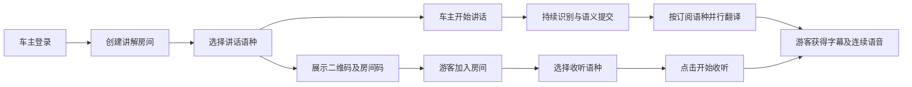
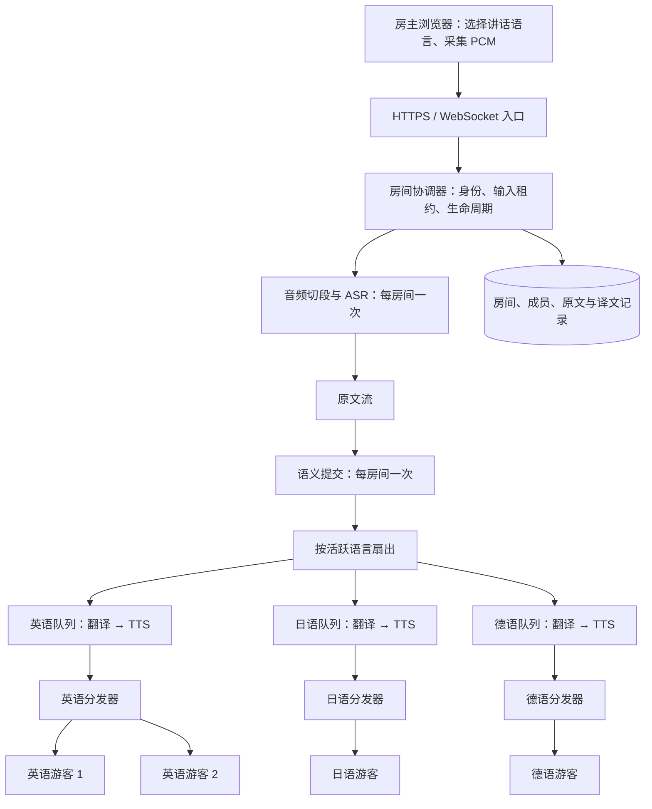
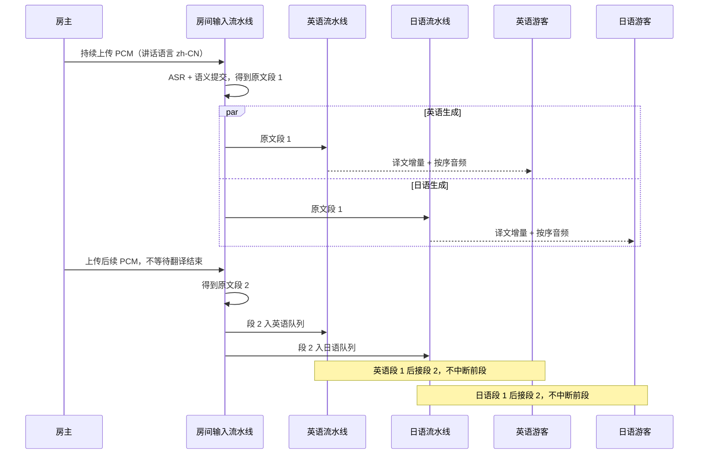
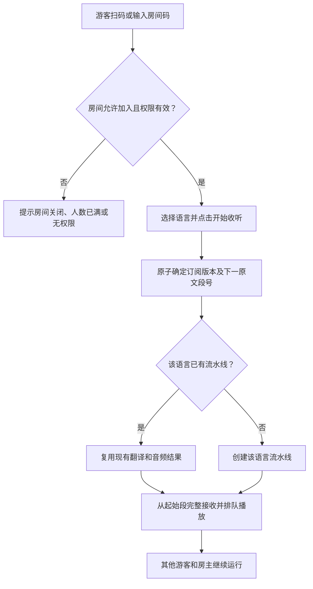
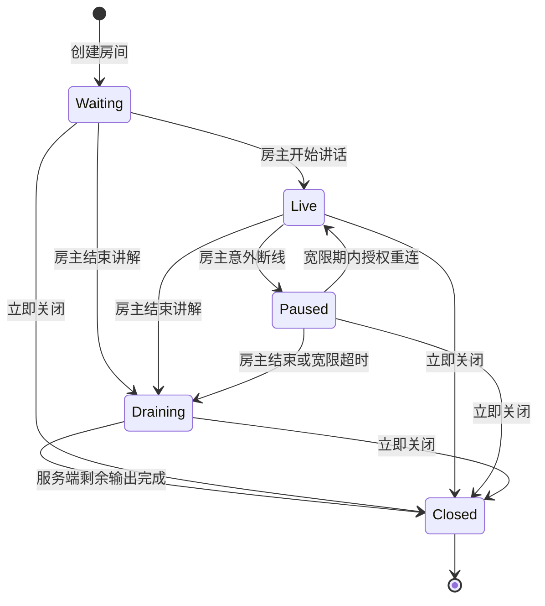
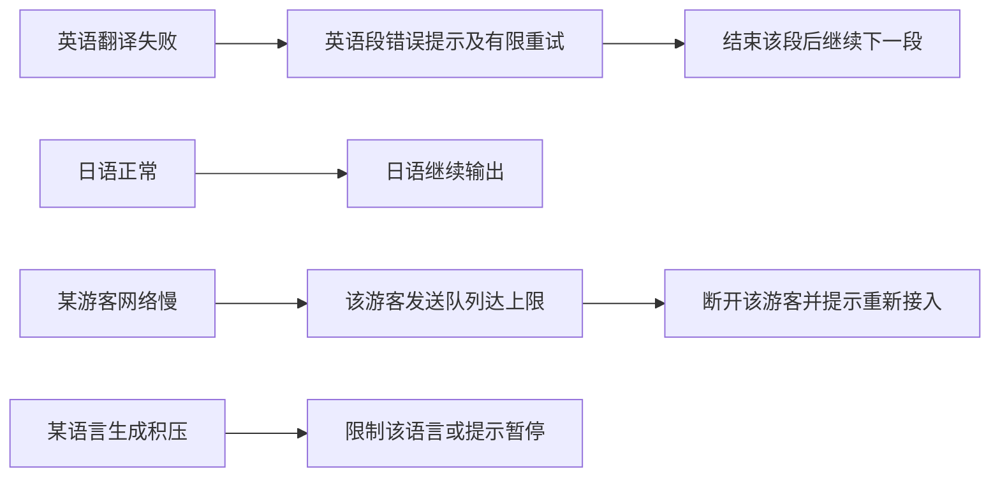

# 黄包车导览：房间式多语种实时翻译方案

> 状态：原始设计与目标行为。2026-10-26 已交付单实例试点实现，包含 H5、支付宝原生小程序、后台车夫手机号授权及 WebAPI。实际范围、接口、DDL 和待验收边界见 [交付说明](../../outputs/room-translation/README.md)；本文其余内容保留为完整设计目标，不代表每项均已实现。
>
> 场景假设：“黄包车主”是讲解者及房主；游客通过二维码或房间码加入，只接收讲解，不向房间上传语音。本文先覆盖一位房主持续讲话、多位游客选择不同语言收听的场景。

## 1. 结论

**可以在当前实时翻译 Demo 的基础上扩充。**麦克风采集、PCM 重采样、ASR、语义切段、翻译 Agent、TTS 与连续播放都可以复用；需要新增房间管理、角色权限、语言订阅、按语言调度和多人分发。

关键改造是把当前“一个用户、一个连接、一个目标语言”的翻译会话，拆成“一个房间、一条原文流、多条语言输出流”。不能只修改页面，让所有游客共用当前接口：现有接口会校验会话归属，且整个处理生命周期绑定单个 WebSocket。

推荐原则：

- 房主上传一份音频，服务端只识别一次、判断一次语义边界。
- 按有人订阅的目标语言启动翻译，各语言之间并行。
- 同语言、同音色配置的游客共享译文和合成音频，不为每位游客重复调用模型。
- 每个语言内部按原文段号顺序处理与播放；新段到达不打断上一段。
- “同时输出”表示各语言并发生成、就绪即播，不承诺不同语言在同一时刻播放同一句。

## 2. 现场使用流程



房主端展示：房间状态、讲话语言、游客数量、各语言订阅人数、识别原文、输入音量、翻译积压和结束讲解按钮。房主通常关闭译文外放，避免再次录入。

游客端展示：房间名称、收听语言、原文与译文字幕、开始收听、静音、连接状态和当前延迟。游客使用耳机；首次点击“开始收听”用于解锁浏览器音频播放。

## 3. 当前能力与缺口

| 模块 | 现有实现 | 房间化需要的改造 |
| --- | --- | --- |
| 音频输入 | `mic.js`、`capture.worklet.js`、`pcm.js` 持续发送 16 kHz 单声道 PCM | 仅房主可上传，增加输入连接租约 |
| ASR 与切段 | `DuplexTranslationSession` 负责接收、切段、识别 | 从单连接会话移到房间级输入流水线 |
| 语义提交 | `TranslationCommitter` 与边界判断 Agent | 按房间和输入轮次复用一次，提交结果广播给语言队列 |
| 翻译 Agent | `RealtimeTranslationAgent.TranslateAsync` 接收原文和单一目标语言 | 为不同语言创建独立调用，受并发配额约束 |
| 翻译业务服务 | `TranslateWithAudioAsync` 关联用户会话并输出翻译/TTS 事件 | 核对落库、会话互斥、额度和取消机制，避免多个语言争用同一会话 |
| 播放器 | `player.js` 串行解码和排期，不因后续段到达停止 | 增加语言订阅版本、音频分片去重和断线恢复策略 |
| 连接 | 文档 96：一个 WebSocket 输入和输出 | 新增房主输入连接与游客订阅连接 |
| 身份 | 无 Token 时游客登录；校验会话归属 | 增加房主、游客角色和房间成员权限 |
| 部署 | Node 代理到 .NET，Nginx 转发 WebSocket | 增加房间状态、资源限制；多实例时需要房间归属路由 |

源码依据：前端 `public/realtime.js`、`public/player.js`；后端 `DuplexTranslationSession.cs`、`TranslationCommitter.cs`、`RealtimeTranslationAgent.cs`；接口文档 96。

## 4. 推荐架构



例如 20 位游客中有 10 位选英语、6 位选日语、4 位选德语：每个已提交原文段产生 3 条语言翻译流水线，而非 20 条。音频按语言共享合成，网络下行仍需要分别发给每位游客。

音频复用键至少包含：房间、输入轮次、原文段号、目标语言、音色、语速、音频格式及配置版本。MVP 固定每语言一种音色，避免游客自定义导致合成数量膨胀。

## 5. 并行、顺序与“同时输出”



### 推荐：语言之间并行，语言内部按序

每个语言有独立的有界任务队列和取消作用域，顺序消费原文段；用房间及系统级并发限制控制模型调用。英语变慢不会阻塞日语的入队或输出。分发器只投递到游客的有界发送队列，不同步等待每个游客的网络发送。

不要让多个语言直接读取同一个 `Channel.Reader`：那会变成竞争消费，不是每语言都收到完整原文。应由调度器把不可变原文提交记录逐一投递到每个活跃语言队列。

语言数量超过并发配额时，采用明确的等待或拒绝策略，不能承诺无限并发。若以后需要同语言多个段并行生成，必须增加按段号重排缓冲；MVP 先保持同语言串行。

### 不同语种无需强制同步起播

不同语种的翻译耗时、语音长度都不同。等待所有语种完成再一起播放会让最快的游客等最慢语种，增加延迟。推荐谁先就绪谁先播，每位游客内部顺序一致即可。

即使生成足够快，目标语音长度长期超过房主讲话时长，也会累积播放延迟。应展示延迟并提示房主适当停顿；允许客人主动选择“跳到最新”，但不能自动打断或静默丢掉旧语音。实时翻译无法同时无限保证低延迟、完整播报和任意快的输入速度。

## 6. 房间、语种和会话规则

| 情况 | 建议行为 |
| --- | --- |
| 创建房间 | 服务端确定房主身份，生成房间 ID、有限期加入码及二维码 |
| 游客加入 | 可沿用游客登录；加入码只用于查找/申请加入，服务端仍签发并校验成员权限 |
| 房主选择源语言 | MVP 要求明确选择；自动检测保留为可选能力，不承诺混合语种识别质量 |
| 房主切换源语言 | 结束并排空当前输入轮次，再创建新轮次；不能把两种语种的 PCM 混进同一个 ASR 缓冲 |
| 同源同目标语言 | 可直接分发识别原文并按需 TTS；若要听房主原声，应另做原声传输功能 |
| 第一位某语言游客加入 | 建立该语言流水线，从下一个尚未提交的原文段开始，返回明确的起始段号 |
| 中途加入 | 默认实时接入，不补播全程；可显示有限的近期完整字幕 |
| 游客切换目标语言 | 在新的原文段边界切换，旧语音默认播完；仅显式选择“立即切换”才清空旧队列 |
| 某语言无人订阅 | 停止为未来段创建该语言任务；短暂宽限期保留当前任务和缓存，避免反复加入导致重复调用 |
| 房主结束输入 | 停止采音，排空 ASR、提交和各语言生成队列，再发送房间输出完成事件 |
| 房主短暂断线 | 暂停输入，保留房间；重连取得新租约及轮次，不声称恢复断线时丢失的 PCM |
| 游客断线 | 不取消房间生成；重连按最后完整事件游标恢复字幕，音频先采用显式重新收听策略 |
| 房主关闭房间 | 拒绝新输入，按“正常结束”或“立即关闭”的明确动作处理剩余输出 |

“服务端输出完成”不等于所有游客已播放完毕；游客仍需播放本地队列。房主 WebSocket 断开不能直接取消已提交内容的语言任务，生命周期应由房间协调器管理。

### 6.1 随时加入：从完整新段开始收听

房间处于等待讲解、讲解中或房主短暂离线状态时，允许授权游客加入；正在排空输出或已经关闭时，不再接受新的实时收听订阅。游客加入不暂停房主输入，也不重启已有语言流水线。

服务端在订阅正式生效时，原子记录输入轮次 `epochId`、订阅版本和 `startSequence`。默认将起点设为该时刻最新已提交原文段号加一，只接收此后的完整翻译段，不从正在生成或播放的段中间接入。如果当前原文缓冲尚未提交，则下一次提交可作为新游客的第一段。

例如第 10 段已提交，无论它正在翻译还是已经播放一半，新游客都从第 11 段开始。即使某语种的第 8、9 段仍在积压，也不补播给新游客。若房主暂时没有新的讲话，页面显示“已加入，等待下一段讲解”，而不是误报连接失败。

同语种游客共享生成结果，但各自有独立的订阅起点和播放进度，不要求所有游客同步起播。近期完整字幕可以单独展示为历史记录，不能自动送进新游客的朗读队列；默认不补播全程。



### 6.2 随时退出：只停止当前游客

游客点击“退出房间”后，客户端立即停止本机音频、清空播放队列并关闭订阅连接，同时尽力调用退出接口。服务端幂等撤销该成员当前订阅、关闭关联连接、清理发送队列并更新人数。退出请求失败时也应允许客户端离开，服务端再通过连接关闭或心跳超时完成清理。

游客退出不取消房间 ASR、语义提交或其他游客的语言任务。最后一位某语种游客离开后，不再为未来段创建该语言任务；短暂宽限期保留当前任务和缓存，之后释放资源。宽限期内重新加入仍按新的订阅起点过滤旧段，不能自动补播离开期间的音频。

同一连接关闭、主动退出和心跳超时可能重复到达，清理必须幂等，人数不能重复扣减。MVP 建议每位成员仅允许一个有效收听连接；重连替换旧连接后，旧连接迟到的关闭事件不能撤销新连接的订阅。通过服务端连接代次及租约校验保证这一点。

### 6.3 断线、重连与房主离线

| 情况 | 客户端行为 | 服务端行为 |
| --- | --- | --- |
| 游客主动退出 | 立即停播并离开页面，不自动重连 | 撤销当前成员订阅及恢复权限；再次加入需走加入流程 |
| 游客断网或关闭页面 | 已知断线时显示提示；关闭页面无法保证发送退出请求 | 通过连接关闭或应用心跳超时标记离线、释放人数及订阅资源 |
| 游客短暂断线后重连 | 重新校验成员凭证；必要时再次点击收听以恢复音频 | 在房间仍开放时建立新连接代次，返回新实时起点；按有效游标有限恢复字幕 |
| 房主意外掉线 | 游客显示“讲解暂停”，已有音频继续播放 | 保留房间，处理已接收的完整采样及已提交任务，启动重连宽限计时 |
| 房主在宽限期内重连 | 房主确认麦克风可用后恢复讲解 | 重新授权并取得输入租约，建立新输入轮次，旧连接不能继续发音频 |
| 房主超过重连宽限期 | 游客收到结束提示，播完已接收队列 | 停止接受输入和新成员，排空剩余任务后关闭房间并回收资源 |

游客重连默认不自动重播旧音频，避免重复或播放半句话；如需回听，应由独立入口从保留的完整语音段开始。恢复原成员身份依赖有效登录或恢复凭证，不能仅依赖前端缓存的成员 ID。

房主断线时，服务端可排空已经接收的完整 PCM 采样和已识别原文，但不能恢复尚未送达的采样。新轮次与旧轮次按顺序串接，旧轮次的尾段先于新轮次输出；播放器按“轮次顺序 + 段号”排队，不能把新轮次重新从 1 开始的段号与旧轮次混淆。

应用层心跳、游客离线判定、语言无人订阅宽限期和房主重连宽限期应分别配置。试点可先采用心跳 15 秒、游客 45 秒无有效响应判离线、语言缓存宽限 15 秒、房主重连宽限 60 秒，再根据移动网络实测调整。这些是建议初值，并非现有接口行为。

### 6.4 房间生命周期与结束方式



- **游客退出房间**：只终止自己的收听，不改变房间状态。
- **房主结束讲解**：进入排空状态，停止录音和新成员加入，剩余识别、翻译及合成继续完成；服务端输出完成后，游客继续播完本地队列。
- **房主立即关闭房间**：明确取消未完成任务，发送立即停止事件；在线游客停止播放并退出，离线客户端恢复连接后也不能继续订阅该房间。
- **房主意外掉线**：先暂停并保留重连机会，不直接当作主动关闭。暂停状态仍可加入，新游客等待讲解恢复。

正常结束与立即关闭应在界面和事件中明确区分。`room.closed` 应携带关闭模式和原因：正常结束时不清空本地音频；立即关闭时要求在线客户端停止播放。关闭事件无法到达断网设备时，不能保证远程即时停止其已缓存音频。

## 7. 建议接口与事件（新增，尚不存在）

### HTTP

| 方法 | 建议路径 | 用途 |
| --- | --- | --- |
| POST | `/api/TranslationRooms` | 房主创建房间并指定源语言 |
| POST | `/api/TranslationRooms/join` | 游客使用加入码申请加入并选择目标语言 |
| POST | `/api/TranslationRooms/{roomId}/leave` | 游客幂等退出当前成员订阅，关闭关联连接；不影响房间及其他游客 |
| GET | `/api/TranslationRooms/{roomId}` | 已授权成员读取房间状态 |
| POST | `/api/TranslationRooms/{roomId}/subscription` | 更新目标语言及音频开关 |
| POST | `/api/TranslationRooms/{roomId}/end` | 房主正常结束输入并排空输出 |
| POST | `/api/TranslationRooms/{roomId}/close` | 房主关闭房间 |

### WebSocket

- `/api/TranslationRooms/{roomId}/input`：房主连接，只接收该房间当前输入租约持有者的 PCM 与控制消息。
- `/api/TranslationRooms/{roomId}/events`：游客及房主订阅连接，接收已授权的字幕、音频、状态事件，不接受游客 PCM。
- 可以沿用文档 96 的登录 Token 子协议鉴权方式，但新增路由必须同步扩展后端凭据提取白名单、Node 代理路由及 Nginx 转发规则。
- 同一浏览器若刷新导致游客身份变化，不能仅凭旧 `memberId` 恢复身份；需要持久登录或服务端签发可撤销的成员恢复凭证。
- 订阅连接启动时返回 `subscription.ready`，包含有效 `epochId`、`startSequence` 和订阅版本；客户端收到确认后展示“等待下一段讲解”。加入与切语言时的起点均由服务端确定，避免订阅和原文提交并发时漏段或接入半段。
- 应用层心跳使用 `ping/pong` 或等效消息维护连接存活，不能依赖浏览器关闭页面时一定调用退出接口。成员清理需校验连接代次，退出接口只操作当前授权成员。

事件建议至少包含以下定位字段：

```json
{
  "type": "translation.final",
  "roomId": "2080000000000000001",
  "epochId": "2080000000000000002",
  "eventId": "2080000000000000123",
  "sequence": 12,
  "targetLanguage": "ja",
  "subscriptionVersion": 3,
  "payload": {
    "text": "こちらは旧市街です。"
  }
}
```

业务 ID，包括 `roomId`、`memberId`、`epochId`、`sessionId`、`eventId`，在 JSON 和前端始终使用字符串。`sequence` 是轮次内有上限的顺序计数，可用安全整数；ASR 段号与翻译段号保持分离，通过 `sourceFrom/sourceTo` 关联。

音频事件另外携带原文段号、音频句号、分片号、编码配置版本；`eventId` 用于去重及恢复。`subscriptionVersion` 用于过滤切换语言前的在途消息，防止旧语言音频混入新队列。服务端按每个游客自己的订阅版本封装共享结果，不能把某位游客的版本写进公共音频缓存。

建议事件：`room.started`、`room.paused`、`room.resumed`、`room.draining`、`room.closed`、`room.members.changed`、`subscription.ready`、`subscription.changed`、`transcript.final`、`translation.committed`、`text.delta`、`translation.final`、`audio.started/delta/done/error`、`language.error`、`room.output.completed`。人数变化向房主返回必要的在线总数和分语种人数，不向所有游客广播成员凭据或隐私信息。不同语言及音频事件的顺序、去重、重连规则需要在新增接口文档中明确。

## 8. 现有翻译 Agent 如何复用

`RealtimeTranslationAgent` 已提供“原文 + 目标语言 → 流式译文”的能力，适合由语言流水线分别调用，无需为每个游客创建专属 Agent。

但不能简单对当前 `TranslateWithAudioAsync` 使用 `Task.WhenAll` 就算完成。它带有 ExhibitChat 会话归属、存储和语音编排逻辑，需要先核对并发和隔离边界。

建议分两步：

1. 试点阶段：每个房间语言流水线使用独立的内部翻译会话，由有权使用它的房主身份调用；游客只订阅结果，不直接访问房主的 ExhibitChat 历史。源原文和语言结果单独关联，控制重复落库。
2. 正式阶段：抽取可复用的“翻译流 + TTS 流”服务，让房间服务负责成员权限、计费和存储，避免房间逻辑长期绑定聊天会话。客户端不得传入其他用户 ID 以冒充房主。

不要把音频分别发送到每个游客的文档 96 会话中，否则每位游客都会重复切段、ASR 和语义判断，成本增加，原文边界也可能不同。

## 9. 异常、容量与部署



- 慢游客不能阻塞同语种其他游客；每个游客独立发送队列，达到上限明确断开，不无限缓存。
- 单语言错误不得触发整个房间取消。对已经发出部分字幕或音频的任务，不允许无标记地整段重试，否则会重复播放；需任务尝试号、结果替换或仅字幕降级规则。
- 每房间限制人数、活跃语言数、持续时间；系统限制 ASR、翻译和 TTS 并发，并设置有界队列与费用上限。
- MVP 建议先限定为少量房间、每房间最多 3 个目标语言的小规模试点；具体人数上限通过真实移动网络和供应商配额测试确定。
- 后端实例持有房间输入流水线。单实例阶段可以内存调度，持久存储房间和已提交文本；实例重启时显式结束未恢复房间，不能承诺音频无损续传。
- 多实例阶段必须把同一房间输入和订阅路由到房间所属实例，或通过可靠的房间分发层转接。仅加入 Redis 存储元数据不会自动同步 PCM、工作队列或 WebSocket 连接。
- 如需跨实例重放，选择带保留及游标的事件日志/流；普通 Redis Pub/Sub 不提供断线补发保证。音频缓存需独立生命周期和容量限制。
- Nginx 的 Demo 入口、房间 WebSocket 入口及中间网关都必须透传 Upgrade 和子协议，超时覆盖房间时长；日志避免记录 Token。
- 沿用游客登录可降低加入门槛；房主创建能力需服务端授权和额度限制，不能由前端角色开关决定。房间码应限时、限制尝试次数并可撤销。

### 成本与延迟

```text
每个房间的计算成本
≈ 一份 ASR + 一份语义判断
  + 所有活跃目标语言的翻译成本
  + 所有活跃语言/音色组合的 TTS 成本

网络下行
≈ 各语言音频大小 × 各语言实际接收人数

端到端等待
≈ 音频切段 + ASR + 语义等待 + 队列等待
  + 译文首包/TTS 首包 + 网络传输 + 客户端已排队音频
```

现有接口使用分段 ASR 和语义缓冲，不是逐采样同声传译。文档 96 的约 8 秒是提交阶段等待限制，并非全链路延迟保证。应分别监控 ASR 耗时、提交等待、各语言生成耗时、队列深度、游客播放延迟和断线率。

## 10. 实施顺序与验收

| 阶段 | 交付 | 验收重点 |
| --- | --- | --- |
| 1：房间最小闭环 | 创建/加入、固定源语言、一种目标语言、一位房主多位游客 | 游客不能上传；同语言共用生成；退房不终止房主 |
| 2：多语言并行 | 按语言队列、并发配额、语言隔离、共享 TTS | 同一原文段各语言独立输出；慢语言不阻塞其他语言 |
| 3：连续收听体验 | 订阅切换、晚加入、字幕恢复、音频去重、延迟展示 | 新段不打断旧段；旧订阅音频不串入；刷新不会重复补播 |
| 4：上线运行 | 额度、限流、监控、生命周期、移动端验证 | 弱网与后台恢复可理解；进程重启有明确处理；资源可回收 |

关键测试场景：中文房主同时面向英语、日语、德语游客；同语言加入多人仍只生成一份；某游客掉线不影响其他人；某语言 TTS 失败仍保留字幕；游客切语言不混播；房主正常结束后尾段完整输出；长时间目标语言播报较慢时有明确延迟提示。

加入与退出专项验收：

| 场景 | 预期结果 |
| --- | --- |
| 第 10 段已开始生成或播报时加入 | 从服务端确认的第 11 段开始，不播放第 10 段残余音频；无新段时展示等待状态 |
| 加入与新原文段提交同时发生 | 按服务端原子起点明确归属，不漏掉应接收段，不接收起点前的分片 |
| 新语言首次有人订阅 | 从确认起点创建该语言任务，已有语言持续输出 |
| 某游客主动退出、关页或断网 | 本人按对应策略停止或离线清理，房主和其他游客不中断 |
| 同一退出请求、连接关闭事件重复到达 | 人数仅扣减一次，资源释放幂等 |
| 游客重连成功后旧连接才关闭 | 新订阅仍有效，旧连接不能误删新订阅 |
| 某语言最后一人退出后又有人加入 | 未来任务按订阅恢复；宽限后资源回收；新成员不补播旧缓存 |
| 房主掉线后宽限期内恢复 | 游客看到暂停及恢复状态，已提交内容不中断，新旧轮次顺序正确 |
| 房主重连超时或正常结束 | 拒绝新加入，已有游客收完剩余输出，再结束房间 |
| 房主立即关闭 | 取消未完成生成，在线游客停播；后续加入及重连被拒绝 |

前端可继续采用现有 H5 技术，不必先引入 WebRTC。当前需求是上传 PCM、接收翻译结果，WebSocket 足够。若后续增加原声低延迟直播、游客抢麦或多人对讲，再单独评估 WebRTC/SFU。

## 11. 需要业务确认的边界

- “黄包车主”是否只有一位讲解者，还是需要多人轮流上麦？本方案先按一位处理。
- 游客是否只收听，还是也能提问并反向翻译？后者需要发言仲裁和更多输入流水线。
- 是否需要原声直播、历史回听和录音保存？这些不包含在当前翻译输出能力中。
- 一车人数、同时在线房间数、最大时长、目标语种组合和可接受延迟是多少？容量和费用需据此实测。
- 户外移动网络和设备是否能持续采音/播放？需要在手机浏览器、微信内置浏览器、锁屏及切后台场景实测，不能保证 H5 后台持续运行。

建议先交付“一位房主、游客扫码、最多 3 个目标语种、字幕 + 连续播报”的试点版本，验证现场识别、移动网络、播放积压与成本，再扩展容量。
