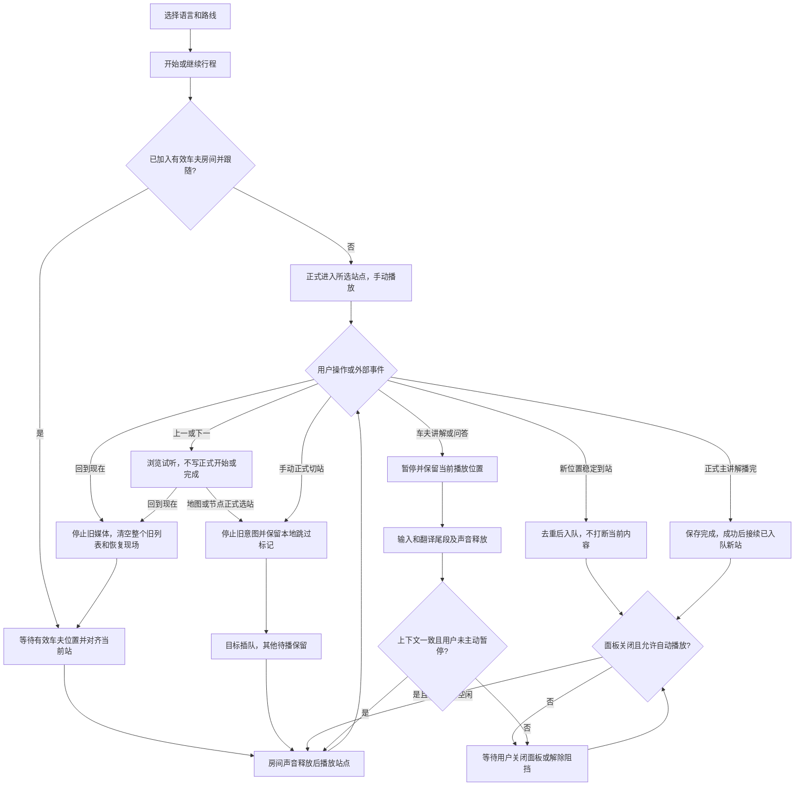

# 2026-11-10 支付宝小程序演示验收记录

## 1. 结论与候选代码

本轮对 `apps/mp-alipay` 重新执行了构建、完整回归、业务动线审查和真实服务／媒体检查，复现并修复 4 处主要逻辑缺陷，新增 16 项场景回归。最终 **361 项测试全部通过，失败、取消、跳过均为 0**。中文 A 线 19 个站点的主讲解音频齐全，现有媒体资源可访问。

**代码回归及线上内容检查通过；原生开发者工具与手机全流程尚未完成验收。** 不能据此承诺“绝对没有 bug”或“真机全功能已经验收”。部分语言存在明确音频内容缺口，今天完整语音演示优先使用中文。

| 项目 | 本轮值 |
| --- | --- |
| 工程 | `apps/mp-alipay`，支付宝原生 App／Page／AXML／ACSS |
| AppID | `2021007110628321` |
| 源码基线 | Git `d472677`，加本轮未提交修复及测试 |
| 构建目录 | `apps/mp-alipay/dist`，最终回归已重新生成 |
| API | `https://www.omahaaigc.com/path-seeker/api` |
| 媒体域名 | `https://omaha-wenlv.oss-cn-beijing.aliyuncs.com` |
| 最终完整日志 | [full-regression-final.log](../outputs/demo-acceptance-2026-11-10/full-regression-final.log) |
| 构建指纹 | [build-manifest.json](../outputs/demo-acceptance-2026-11-10/build-manifest.json)，87 个文件的 SHA-256 |

本轮没有上传／发布小程序，没有修改生产路线内容，没有写入生产行程或创建房间；线上检查仅建立一个临时游客身份并读取公开业务内容。

## 2. 已复现并修复的问题

| 编号 | 修复前的真实场景 | 修复后的行为 |
| --- | --- | --- |
| F1 | 回到现在匹配已完成 A，A 重听结束；B 新到站已入队，却被手动浏览保护一直挡住 | 回到现在保留自动跟随；A 不重复提交完成，重听结束可以接续新到站 B。显式手动重听已完成站仍保持浏览保护 |
| F2 | 正式播放 A 时手动切到 B；旧 A 被完全移出队列，重复定位可重新加入 A，B 完成后又播放 A | 取消旧播放意图时保留本地已跳过标记，重复 GPS 不再自动补播；B 插到队首，其他待播保留，不伪造 A 的服务端完成 |
| F3 | 上一／下一正在试听 B，再点地图 B 正式选站，被同站防重提前返回吞掉 | 正常提交 B 的正式开始；正式节点重复点击则打开正文，并从原时间恢复暂停的媒体，不重复开始、不重建音频 |
| F4 | 豆包原文序号 1、译文序号 2；译文 2 已结束，原文 1 仍被记为永久待译，车夫暂停后景点不恢复 | 按源语言和收听语言区分翻译路径：豆包实际支持的方向跟踪独立译文，中文同语种、粤语等回退路径继续跟踪原文；真正的输入、译文和尾音结束后恢复原景点原时间 |

同时校正了手动插队的待播数量：只统计待播项，不把已完成或已跳过项算进去。

修改的生产代码为 [导览页面](../apps/mp-alipay/src/pages/tour/index.js) 和 [房间会话](../apps/mp-alipay/src/services/translation-session.js)。没有更改已有的站点完成规则，也没有新增可见“手动完成”按钮。

## 3. 修复后的核心业务动线



“回到现在”后的旧手动站不会作为旧列表被补播。后续站点需要新的有效位置触发；已经完成的站点不会仅因堵车、重复坐标再次自动排队。用户显式重新播放或再次回到现在仍可重听。

## 4. 自动化验证范围与结果

| 验证层次 | 结果 | 实际覆盖 |
| --- | --- | --- |
| 首轮当前基线 | 345／345 通过 | 证明原有回归通过；随后业务审查仍发现缺陷 |
| 新增导览验收 | 8／8 通过 | 试听转正式、同站恢复、插队防补播、回到现在清列表与后续新 GPS 接续、已完成站重听后跟随、面板入队、手动重听保护 |
| 新增房间验收 | 8／8 通过 | 原译不同序号、输入排空但仍待译、译文失败释放、旧链路兼容；补查中文→中文、中文→粤语、俄语→日语、英语→英语回退队列，验证恢复原景点第 17 秒 |
| 修复后最终全套 | 361／361 通过 | 重建产物后执行全部 `tests/*.test.cjs`；失败／跳过／取消均为 0 |
| 构建静态校验 | 通过 | JS 编译、SDK 正则兼容、AXML 表达式与标签、事件处理函数、组件引用与页面文件 |
| 页面跳转静态核对 | 通过 | 源码字面页面跳转目标均已在 `app.json` 注册 |

完整套件还包含身份／会话刷新与隔离、邀请扫码与授权回跳、房间重连、问答与录音模拟、声音优先级、视频和附加媒体、断点、行程保存失败重试、车夫位置时效／精度／前置条件及长期房间音频清理等。

执行命令：

```powershell
pnpm test:mp-alipay
git diff --check
```

测试使用 Node VM 和原生 API 模拟，能稳定验证状态与竞态，但不启动真实支付宝客户端。最终 Node 测试耗时约 2.2 秒，完整命令含构建约 4.6 秒；这一速度不能用于推断真机已完成测试。

## 5. 真实服务与媒体检查

线上检查时间为北京时间 2026-11-10 08:44 起。33 次业务接口均 HTTP 200、业务 code 0，包括游客身份、8 种语言目录、路线、明信片配置及活动行程查询。共 141 个站点的经纬度有效，并有对应语言讲解文本。

全部 185 个唯一媒体地址 HEAD 200、长度大于 0；再次逐个 GET Range 读取前 512 字节，全部 HTTP 206，119 个 MP3、55 个 JPEG、11 个 MP4 的文件签名匹配。未发现 HTML 错误页伪装媒体成功。此检查不等同于完整音视频解码或手机外放验证。

| 语言 | 站点数 | 有主讲解音频 | 完整语音演示建议 |
| --- | ---: | ---: | --- |
| 中文 | 19 | 19／19 | 推荐 |
| 英语 | 19 | 19／19 | 内容齐全 |
| 俄语 | 18 | 18／18 | 内容齐全 |
| 法语 | 18 | 18／18 | 内容齐全 |
| 西班牙语 | 18 | 7／18 | 11 站缺音频 |
| 日语 | 13 | 0／13 | 13 站缺音频 |
| 韩语 | 18 | 14／18 | 4 站缺音频 |
| 粤语 | 18 | 10／18 | 8 站缺音频 |

合计 36 站缺主讲解音频。前后置音频或视频不替代主讲解；缺音频时有文字内容，但不能当作完整主讲解自动完成。不同语言的站点数量也没有完全对齐。

证据明细：[线上内容报告](../outputs/demo-acceptance-2026-11-10/service-check.md)、[服务与资源结果](../outputs/demo-acceptance-2026-11-10/service-results.json)、[房间审计说明](../outputs/demo-acceptance-2026-11-10/room-flow-audit.md)。这些输出未保存访问令牌。

## 6. 原生环境边界与演示前的最后确认

本机存在并正在打开支付宝开发者工具 `mp-alipay`，但桌面操作工具访问时被拒绝，原文为 `Computer Use was not approved to use 小程序开发者工具`。本轮没有取得原生编译、模拟器页面或手机预览通过的证据。

以下项目仍需在演示设备／体验版实际操作，不能由自动化通过数替代：

1. 重新编译本次 `dist` 并用手机打开同一候选版本，确认中文路线和原生地图显示、主讲解实际出声。
2. 使用游客演示账号扫码加入车夫 APP 的房间；车夫位置更新能传到小程序并触发到站。仅游客手机移动不会触发车夫定位。
3. 正在试听其他站时点击回到现在，确认旧声音停止、当前站播放；当前站结束后，车夫进入下一站可正常接续。
4. 车夫讲解抢占后暂停，等最后一段译音结束，确认景点从原位置恢复。问答音频抢占后房间会暂停收听，当前交互需在房间手动恢复。
5. 若演示手机号授权、语音问答或切后台，实际完成一次手机号登录、录音上传和前后台往返；平台权限、设备录放并行和后台调度仍以手机为准。

体验版／正式版还需确认 API 与 OSS 媒体域名均在对应平台白名单。开发工具能访问及本机 HTTP 检查通过不能证明平台白名单生效。

业务动线完整说明及更多组合场景见 [tour-business-flow.md](./tour-business-flow.md)。
