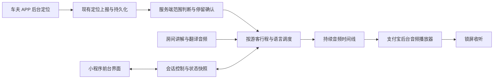

# 支付宝息屏自动触发节点：调研与验证方案

日期：2026-11-10。约束：游客必须只使用支付宝小程序；车夫可继续使用现有 Android APP。

实施更新：探针之后，正式 `/TourAudioSessions`、司机位置到站引擎、真实讲解编排、游客会话和正常游览入口已实现。部署与测试以 [正式持续讲解说明](alipay-server-tour-audio-deploy-test.md) 为准；双端真机锁屏结果仍待现场验收。下文记录 2026-11-10 调研当时的代码状态，包含当时尚未实现的历史说明。

## 结论与实施选择

修复前的现有代码会在切后台时主动切断位置来源，播放引擎也并非支付宝官方后台音频引擎。因此当前故障不能全部归因于操作系统挂起。本轮已修正主动断链，HTTPS 景点音频已接入官方后台播放器，并修正隐藏页面的房间声音释放与音频恢复。系统是否继续调度支付宝 JS、能否跨文件和跨节点持续播放，仍需真机验证。

已完成的客户端修复：

- `config.background=true` 时保留已连接的游客房间及位置轮询；后台断线等待回前台恢复，不在后台无限重连。房主录音、未完成的重新入房请求及显式暂停仍会停止。
- `config.backgroundAudio=true` 时，HTTPS 景点音频使用 `my.getBackgroundAudioManager()`。本地临时音频、问答和房间译音仍走前景播放器；API 不存在或开关关闭时也走前景路径。
- 后台模式保留房间状态订阅，声音释放后可按原位置续播主讲解音频；视频、单独额外音频的恢复仍等待前台。页面卸载时清理订阅。
- 原生系统面板暂停、停止后不因页面恢复强制起播；系统面板继续播放可解除这次原生暂停。单例播放器逐段解绑监听，并拒绝迟到的旧段回调。
- 回前台检查保留连接的业务 pong，超过 45 秒即重新入房；新鲜连接发送 ping。移除未在核对的官方文档列出的 `supportBackgroundPlay`、`requiredBackgroundModes`。

回退方式：只关闭 `backgroundAudio` 可切回前景播放器并保留游客连接；关闭 `background` 则隐藏页面时暂停音频并停止跟随轮询。

官方支持后台音频，但没有承诺后台音频可让所有小程序业务 JavaScript、定位轮询、WebSocket 回调持续运行。官方 FAQ 明确回答“小程序不可以延长后台保活时间和取消后台保活”。调研没有找到可信、可直接保证 Android/iOS 支付宝息屏持续执行任意业务代码的公开方案。

建议按两个阶段推进：

1. **先验证真机媒体能力**：使用现有小程序内新增的隔离验证页，分别验证有限 MP3 后台播放、同一条连续音频流的后台播放、后台 JS 是否仍执行。这是后续架构的前置条件。
2. **通过后实施服务端导览调度 + 同一条后台音频流**：车夫上报位置后，服务端完成范围判断、去重、节点排队和音频编排。游客在前台点击开始，交给 `my.getBackgroundAudioManager()` 播放一个持续的网络源；之后新节点音频直接出现在既有流里，关键路径无需游客 JS 收推送或重新设置音频 URL。

连续 MP3、HLS 等传输在支付宝后台播放器上的长期兼容性仍未获真机证明。本文把它们列为实验候选，不把“支持网络地址”解释成“支持任意直播协议”。如果目标机型不支持稳定连续流，而后台 JS 又会停止，则“游客只用支付宝、锁屏持续听到新节点”无法由当前公开 API 作出可靠保证。

## 补充调研：WSS、桌面组件与定向原生能力

本节补充于 2026-11-10。小程序切后台不等于每台手机立即停止全部 JS；支付宝运行机制仍描述了后台运行和热启动。但公开文档没有保证锁屏期间业务 JS、定时器与 WSS 消息回调持续执行。必须区分“连接仍存在”“原生网络仍收包”“JS 回调正在执行”“原生播放器正在发声”四种现象。WSS 心跳教程不能证明锁屏保活；本次阅读的 [支付宝小程序实现 websocket 通信功能](https://blog.csdn.net/qq_39467560/article/details/135535755) 仅使用 JS `setTimeout` 检测、重连，并未提供 Android/iPhone 锁屏实证。

### 桌面快捷入口与真正的小组件

“添加到桌面”提供再次进入小程序的入口。官方搜索结果对应 [my.hideAddToDesktopMenu](https://opendocs.alipay.com/mini/api/optionmenuitem)，没有授予任意 JS 后台执行权的说明。添加图标本身不能证明息屏自动播放成立。

真正的系统桌面小组件也不能仅凭显示或更新信息推导出小程序 JS 活着。[Apple：Keeping a widget up to date](https://developer.apple.com/documentation/widgetkit/keeping-a-widget-up-to-date) 明确说明 WidgetKit 由独立进程渲染，即使小组件可见，扩展也不是持续运行；刷新受系统预算调度。这份原生 WidgetKit 文档不是支付宝向第三方小程序开放同等能力的凭据。不能把可点击的播放操作视作无人操作时自动触发新节点。

### 新线索：支付宝原生锁屏组件

本次找到 [频繁解锁太麻烦？支付宝实现锁屏组件新能力](https://developer.aliyun.com/article/1588978)，发布于 2024-08-18，文章标注来源“支付宝体验科技”，阿里云社区发布账号为“码农小达人”。它是技术文章，不是普通小程序开放 API 的接口文档。

文章展示支付宝运动与出行的测试接入，提到正在对接运动、听书业务，以及外部业务可洽谈接入。代码使用 Android `BroadcastReceiver`、`Activity`、`WindowManager`、`WakeLock`，通过 `registerCustomHandler` 和 `BgServiceDataManager` 管理业务。文章的 `onUpdateData` 定时回调属于这套原生组件设计，不能当成小程序页面 JS 的持续回调保证。其测试包括锁屏界面持续亮屏 30 分钟，也不能等同于真正黑屏时音频持续播放。

这条路线值得作为向支付宝申请原生业务接入的候选，尤其文章提到听书，但尚缺四项证据：文旅导览小程序能否申请；是否有开放给小程序的桥接接口；真正黑屏后能否由服务端事件驱动新音频；是否有 iPhone 对等能力。本次官方站内“桌面小组件”“锁屏组件”查询未找到直接对应的公开接入说明，不能据此断言内部或定向能力不存在。

### 新线索：定向 RTC room

[支付宝：RTC room 组件](https://opendocs.alipay.com/pre-open/08757t?pathHash=d1fc6c9f) 是标明“邀测文档，仅供受邀用户使用”的原生能力。文档列 Android 和 iOS 支持；实时音视频按经营类目申请、仅支持一对一；三方对接需获得 MRTC 参数和挂包。[方案介绍](https://opendocs.alipay.com/pre-open/0877lv?pathHash=37bc08e1) 说明需由支付宝 BD 申请，服务端通过 RTMP 对接三方 RTC。[ZEGO 支付宝音频通话接入](https://doc-zh.zego.im/real-time-voice-miniprogram/quick-start/alipay/implementing-voice-call) 也确认需要联系技术支持、开权限、挂包及使用原生组件。

其中 `enableProximityMonitor` 说明为“支持贴耳距离监测，使能后自动息屏条件下通话保持”。这是贴耳感应自动息屏的描述，不足以证明手动锁屏、切后台、长时间无音频或两端网络恢复都有效。RTC room API 的浮窗也没有提供这些保证。因此可以作为申请评估的第二条原生路线，不能声称已找到可直接在普通文旅小程序启用的锁屏方案。

### 连续音频流的证据边界

“服务端调度 + 同一原生后台媒体源持续输出”仍是结合公开后台音频能力与通用流媒体技术提出的架构推导，并非本次发现的、已在支付宝 Android/iPhone 同时验证的现成方案。支付宝 BackgroundAudioManager 属性表没有 uni-app 通用文档中的 `protocol`；不能照搬 `protocol='hls'` 就声称支付宝支持 HLS 直播。

前一段讲解结束后，候选方案继续发送同一编码时间线里的静音，再把服务端后续判定的节点音频写入同一媒体源，避免游客 JS 收 WSS 后切 `src`。是否被支付宝后台播放器接受、静音数分钟后是否继续、新音频实际延迟和断网恢复，仍须 Android 与 iPhone 真机验收。

### 正式实现状态

已按之前授权开始现有 WebAPI 的请求模型、音频编解码器和房间独立媒体租约；小程序侧也有未接通的媒体会话适配草稿。服务端会话调度与新控制器尚未完成，未发布。小程序 `serverTourAudio` 默认关闭，防止调用尚未接通的接口。为优先回答本次能力核查，已暂停扩大正式实现。

暂停前已确认现有小程序构建与 375 项回归测试全部通过；后端媒体租约及原有房间相关 52 项测试通过，其中包括 13 项新增媒体测试。这些测试使用本地运行或模拟原生对象，均不构成 Android/iPhone 锁屏能力证明。

## 已确认的项目中断链路

### 位置已经来自车夫 APP

`apps/mp-alipay/src/services/location.js` 中 `watch()` 每次请求结束后等待约 1 秒读取 `/TranslationRooms/{roomId}/location`。当前不调用支付宝本机定位。

只有 `room` 为游客房间、`disconnected` 为 false、房间状态有效时才继续轮询。重复采样不产生新判定；样本过期、停止共享、换房等会清除待判断状态。

### 修复前：切后台主动断开房间，连带取消位置轮询

修复前调用链：

```text
App.onHide()
  → translation.suspend()
  → remember() + disconnect(true)
  → state.disconnected = true
  → location.watch() 的订阅得到新状态
  → next roomId = ''
  → clear() 取消定时器与在途请求
  → 不再获取新的车夫位置
```

修复前这条链在 `config.background=true` 时也发生。现在 `App.onHide()` 会显式调用 `translation.suspend({ preserveConnection: config.background })`；后台模式保留健康的已有游客连接，显式 `translation.suspend()` 仍保留原来的断开语义。`background` 只是应用逻辑开关，不能覆盖支付宝系统的后台权限限制。

修复前导览页的 `onHide()` 虽然保留 `_watch`，但内部已经因房间断开而停止请求；页面还退订 `_roomSubscription`。本轮在后台模式保留两项订阅，并允许房间声音释放后恢复主讲解音频及推进队列；卸载页面仍清理全部订阅。

### 修复前使用前景音频，本轮接入官方后台音频

修复前 `apps/mp-alipay/src/services/audio.js` 使用 `my.createInnerAudioContext()`，逐段结束后通过 JS 回调推进队列、销毁旧上下文并创建下一段。本轮 HTTPS 景点音频改用全局唯一的 `my.getBackgroundAudioManager()`，每段解绑旧监听并复用该单例，不调用不存在的 `destroy()`；后台单例不参与前景上下文预热。

旧代码尝试赋值 `context.supportBackgroundPlay = true`，同时 `app.json` 存在 `requiredBackgroundModes: ["audio"]`。本次核对的支付宝 `InnerAudioContext` 属性表没有 `supportBackgroundPlay`，应用配置表没有 `requiredBackgroundModes`。本轮已移除这两项；赋值未抛错不证明原生能力生效。

官方明确说明 `createInnerAudioContext` 属于前景音频，离开小程序或息屏会停止；官方后台方案为 `my.getBackgroundAudioManager()`。不能只给现有对象补一个属性就把它转成后台播放器。

当前跨文件、跨节点仍由 JS 回调推进，客户端修复不能消除这项后台依赖。服务端持续音频时间线尚未接入正式业务。

### 当前语音推送也依赖业务 JS

`apps/mp-alipay/src/services/translation-room.js` 当前经 WSS 接收音频事件，累积音频数据，写入临时文件，再调用 `audio.appendStream()`。代码中名为 stream 的队列并不等于原生播放器持续读取的一条直播流。游客 JS 被挂起后，收事件、文件生成及下一段启动都可能停下。

### 服务端已有合适的位置接入点

后端本地代码：`CulturalTourismSystem.Service/Chat/TranslationRoomService.DriverLocations.cs` 的 `ReportDriverLocationAsync` 已负责鉴权、持久化、样本去重和最新位置更新。可在有效新样本被接受后，投递到有界导览调度队列。

不要在房间 `Gate` 锁内执行地理计算、路线数据库查询、TTS、转码或网络流写入。定位上报的持久化语义也应保留；判定服务失败不能把旧采样伪装成新采样。

### 后端成员资格目前绑定游客 WSS

本轮继续核对发现，`TranslationRoomService.cs` 的 `EventsAsync` 在 WSS 退出的 `finally` 中立即移除游客成员；后台清理还会取消超过 45 秒未更新 `LastSeen` 的连接。`CommitAsync` 只为 `member.Connection != null` 的语言安排翻译。因此，仅让一个外部服务拿游客 Bearer 轮询现有位置接口，游客 WSS 停止后仍会失去成员资格或译音来源。

正式连续流方案必须引入独立媒体会话租约，并同时纳入成员有效性、活跃翻译语言、房间撤权与关闭判定。范围判断放服务端后，不能仍要求游客小程序持续发 WSS 心跳证明在线。验证阶段由服务端代理游客 WSS 也是候选，但会影响小程序自身连接与状态；未经状态和控制代理不直接接入正式端。

服务端可复用的现有输入包括 `GET /ClientCatalog/Route?routeId=...&locale=...`、`GET /RouteVisit/Active?routeId=...`、`GET /TranslationRooms/{roomId}/location`。范围、前置条件与队列必须沿用当前规则；不能只迁移圆形距离判断。后续已开始媒体租约代码，但会话控制器与业务媒体流尚未接通；原有 WSS 路径仍需保持兼容。

## 各种办法的适用性

| 方法 | 能解决什么 | 对本项目的判断 |
| --- | --- | --- |
| 修正 `onHide` 主动断开 | 消除当前必然停止位置轮询的代码路径 | 本轮已实现；单独修改不能承诺长时间锁屏 |
| WSS 心跳、服务端 ping、推送坐标 | 降低前台延迟、检测连接异常 | TCP/WSS 连接存在不代表 JS 回调执行；不具备通用唤醒权限 |
| `BackgroundAudioManager` 播放普通 MP3 | 官方支持离开小程序后继续播放 | 本轮已接入 HTTPS 景点音频；跨文件、跨节点仍依赖 JS 调度，需要单独测 |
| 循环静音音频、极低音量音频 | 可能使部分设备维持媒体会话 | 只能真机实验；后台管理器的公开属性表没有 `loop`、`volume`，不能照搬前景播放器代码；依赖 `onEnded` 循环仍有 JS 依赖 |
| `onTimeUpdate` 中拉位置、安排业务 | 部分机型可能继续派发媒体事件 | 可观测、可实验，不能视作具有执行时限保证的后台任务调度器 |
| 同一个后台音频源持续播放，服务端插入节点音频 | 把到站到发声的关键路径从游客 JS 移走 | 当前约束下最值得验证；长流/直播格式、缓冲及锁屏兼容性尚待验证 |
| Worker、WASM | 分担计算 | 不是前台服务；官方 Worker 文档还注明实验 Worker 可能被回收，无证据支持借此延长后台保活 |
| 前台组件、浮层、隐藏 video、canvas、web-view | 影响 UI 或前台渲染 | 小程序组件无法创建 Android `ForegroundService`；离开宿主后仍受生命周期限制 |
| `my.setKeepScreenOn` + 黑色低亮度页面 | 避免用户未主动锁屏时自动息屏 | 可做前台兜底，离开小程序即失效；不满足真正锁屏要求 |
| 申请后台定位 | 在具备相应产品能力及权限时可能延续定位 | 当前定位源已经在车夫 APP；即使拿到位置，也不能推导出游客 JS 与音频启动持续可用 |
| 电池优化设置、后台允许、锁定支付宝任务 | 部分 Android 机型减少宿主被杀概率 | 可作为真机测试变量，不替代小程序能力；iPhone 不存在同等可控方式 |
| 原生保活插件、双进程、WakeLock、前台通知 | 自有原生 APP 的后台能力 | 已核查的 DCloud 插件兼容表明确不支持支付宝小程序，不能直接接入本项目游客端 |
| 仅把范围判断放服务端，再 WSS 通知游客 | 服务端持续产生节点事件 | 解决事件产生，未解决游客息屏接收和开始发声 |
| 车夫 APP 判断 + WSS 通知游客 | 把计算移到稳定后台来源 | 同上；还增加 APP 路线缓存、版本一致性和上报信任成本 |
| 订阅消息、系统通知、推送 | 提醒用户重新打开 | 不能作为任意小程序 JS 的静默执行器，也无法直接替代连续讲解 |
| 更换 uni-app/Taro 或封装 web-view | 改工程组织方式 | 不增加支付宝宿主授予的后台执行权限 |

以上未验证的方法均不作为“试过后无效”的事实陈述。除明确引用官方文档的能力外，结论是工程约束分析与待测假设。

## 推荐架构：服务端排队，游客持续收听



### 到站判断

- 车夫 APP 继续负责后台定位和上报；默认把判定放服务端，可以复用现有路线数据、权限与持久化，不要求游客安装 APP。
- 保留圆形、多边形、路线顺序、跳跃和重复到访规则。对照 `packages/ts-shared/src/geo-range.ts`、`tour-auto-trigger.ts` 与 `tour.ts` 迁移算法及测试样本，不能只写一个半径距离判断。
- 维持当前默认精度上限 65 米、样本最长 15 秒、不同采样覆盖至少 1.5 秒的停留条件，并处理当前客户端对超过未来 2 秒样本的拒绝。用采样时间推进稳定判断，不能用重复 HTTP 查询或服务器心跳累计停留。
- GCJ-02 和 WGS84 沿用现有转换与配置约定，不为增加命中率扩大节点范围。保留当前路线纠偏关闭的选择。
- 相同房间和路线的几何候选可以复用；完成、暂停、内容锁定、手动选择、语言与节点队列等属于游客行程状态，不能只按房间维护一份公共队列。

### 音频交付

游客在前台明确点击开始收听，创建经过鉴权的媒体会话，再把一个稳定的 HTTPS 源交给后台播放器。进入下一个节点时服务端改变后续媒体内容，游客不必通过 JS 收到一个“播放新节点”的命令。

优先用连续 MP3 做最小能力试验；如被播放器拒绝或被当作有限文件，再单独验证 audio-only HLS。HLS 若成立，还要验证播放列表自动刷新、分片鉴权、分片格式、缓冲延迟和代理行为。不能使用 HLS 视频播放成功来证明后台音频 HLS 成功。

无讲解时保持媒体时间线连续，可评估编码静音间隔或产品允许的背景声。不要靠频繁结束有限文件、在 `onEnded` 重开下一条来规避长流测试；那会重新引入 JS 依赖。完全静音时宿主是否继续维持媒体会话也是验收项。

连续 MP3 需要统一采样率、声道、码率及编码时间线；生产实现应通过解码/重采样/连续编码编排，不能把任意 MP3/WAV/PCM 数据直接拼接。实时讲解仍优先于景点讲解，服务端保存被打断节点的进度；排队与音频媒体时间线需要一同迁移。

普通播放器源设置通常不能附加现有 Bearer 请求头，需要验证媒体请求的鉴权方式。可采用随机、短时、限定房间成员/行程/语言的媒体票据，避免把长期访问令牌放在 URL。离房、停止、房间结束、失去权限时撤销媒体会话。初始 URL、HLS 列表和分片都需要覆盖鉴权；票据失效不应要求息屏 JS 每几分钟主动续期。

连接中断后原生播放器是否会自动重试、何时会停止，不属于服务端可控保证。若必须由 JS 重建媒体源，锁屏期间仍可能无法恢复。首次长期收听、网络切换、断线重连应分开验收。

### 状态与业务边界

- 服务端记录 `detected`、`queued`、`streamScheduled`、`emitted` 等事实；媒体已发送不等于游客实际听完，不能因此写入“已完成”。需要保留前台恢复后的进度对账策略。
- 暂停、关闭跟随、结束行程、切换语言与路线、离房和换账号必须同步到服务端，并拒绝旧响应和旧媒体会话。锁屏系统面板暂停时，服务端可能无法实时得知用户意图；恢复应约定从直播点继续还是补播，不能默认持续积压全部历史音频。
- 停止位置共享、陈旧或乱序样本、车夫撤权、房间关闭后不再产生新节点。游客媒体会话有效性不能绑定“游客 WSS 永远在线”，否则系统挂起后会重复出现本次故障。
- 不改写现有房间约 3 小时有效期；如果产品要求更长，作为显式会话规则处理。
- 所有 `roomId`、`visitId`、`routeId`、`stageId` 等业务主外键保持字符串。客户端和调度事件不能转换成 JS number。
- 前台恢复后获取服务端快照与媒体时间线，合并队列、恢复字幕和进度，不再次为同一节点启动本地音频。
- 视频、题目和必须交互的任务不转化为息屏自动完成；息屏模式只处理允许自动排队和播放的讲解。

### 延迟与成本

定位实际采样和上报间隔、稳定判定窗口、音频生成、服务端排队和原生播放器缓冲共同决定到站发声延迟。必须测端到端时间；不能把本地 1.5 秒停留阈值当作最终播报延迟。

按 48 kbps 连续 MP3 估算约 21.6 MB/游客·小时，三小时约 64.8 MB，不含 HTTP/TLS 开销与重试。100 位游客同时收听约 4.8 Mbps 音频净下行。不同语言或不同游客进度不能盲目合流；也不要直接把验证原型“一位游客一个 FFmpeg 进程”的方式部署到生产。

## 已提供的独立验证原型

本地目录：`outputs/alipay-background-probe/`，由仓库现有 `.gitignore` 忽略；调研报告在 `docs/` 跟踪。

- `server.cjs`：仅监听本机的测试服务器。提供约 30 秒有限 MP3、默认约 35 分钟的节奏化连续 MP3、动态节点连续流、服务器状态和页面 JS 心跳记录。定时流在 0、60、120、180、300、600、900 秒插入提示音；动态流由另一设备触发预置节点，游客端始终使用同一媒体源。媒体生成不依赖 `/ping`。
- `mini/`：可在支付宝开发者工具导入的独立工程，可对照前景 MP3、后台 MP3、定时连续流和跨设备动态触发；每次播放使用新编号，记录 `App/Page onHide/onShow`、JS 执行间隔、音频事件及暂停/停止。
- `control.html` 与 `POST /trigger`：显式配置 `PROBE_CONTROL_KEY` 后开放；控制密钥使用 `X-Probe-Key` 请求头，节点来自预置列表，事件幂等并绑定本轮 `runId`。不接受任意远程音频地址。
- `nginx.audio-probe.conf`：独立 HTTPS 前缀的反向代理示例，关闭流缓冲、缓存与压缩。
- `probe.test.cjs`：本机验证服务端在无页面心跳时插入后续提示音、MP3 可解码、静音间隔、有限文件、心跳隔离、并发上限和断开后释放编码器。

原型不接入真实路线、房间、位置、用户令牌或线上数据库，不包含生产用户鉴权。触发接口的临时控制密钥仅用于受控实验；它验证候选传输和动态注入，不证明支付宝原生播放器兼容。

### 操作顺序

1. 本机安装可用 FFmpeg。执行 `node outputs/alipay-background-probe/server.cjs`。可通过 `FFMPEG_PATH` 指定 FFmpeg 路径，`PROBE_PORT` 指定端口。
2. 可通过 `PROBE_MARKER_FILE` 指定本地可辨识讲话文件。程序解码为最多 10 秒的 PCM 标记；未设置时使用短提示音。有限 MP3 对照扩展为约 30 秒，给锁屏操作留出时间。
3. 将专用测试 HTTPS 域名或专用前缀反向代理到 `127.0.0.1:8787`，关闭媒体响应缓冲、缓存和压缩，允许足够长的流响应。不要把测试服务无鉴权暴露到生产业务路径；它最多同时打开 4 条流，仍只适用于受控测试。
4. 在支付宝测试应用中配置对应请求/媒体域名，导入 `mini/`，绑定测试应用后真机预览。原型的 `mini.project.json` 未硬编码正式 AppID。
5. 填入测试 HTTPS 根地址，点击“后台播放器：连续 MP3 流”，立即锁屏。不要在之后的 60、120、180 秒等时刻解锁或点击；测试者另外记录提示音实际听到时间。
6. 从另一台设备读取 `/status?probe=本轮编号`，检查 `marker`、`js-ping`、流关闭与发送字节数。只有手机实际听到后续标记，才能证明息屏播放成功；服务器持续发字节不能证明耳机发声，播放器缓存也不能证明 JS 活着。
7. 解锁后复制小程序日志，分别记录播放继续、JS 恢复、执行间隔。不要把恢复前台后批量派发的回调当成锁屏期间实时执行。

更直接的动态验收：配置 `PROBE_CONTROL_KEY` 并启动服务，游客选择“锁屏后由另一设备触发节点”，将本轮编号交给控制设备。控制设备打开同一前缀的 `/control`，填入密钥并加载状态。游客锁屏至少 60 秒后，控制设备在随机时刻触发三个不同节点。游客端全程不更换 `src`、不解锁；手机实际按序发声才通过。手动触发成功后，再接模拟位置和真实车夫位置，不能把手动触发原型直接称为正式到站能力。操作详见原型 `README.md`。

PowerShell 示例：

```powershell
$env:PROBE_MARKER_FILE = 'C:\测试音频\可辨识讲话.mp3'
node outputs/alipay-background-probe/server.cjs
node --test outputs/alipay-background-probe/probe.test.cjs
```

### 验收与停止条件

| 验证 | 操作 | 必须证明的结果 |
| --- | --- | --- |
| 官方后台文件能力 | 可辨识有限 MP3 开始后立即锁屏 | 剩余片段继续实际发声 |
| 动态新节点 | 锁屏至少 60 秒后，另一设备随机触发三个节点 | 同一媒体源按序实际出声，不解锁、不切换 src、不依赖 JS 心跳 |
| 长流的后台能力 | 同一源播放后锁屏 15～30 分钟 | 锁屏后才生成的多次提示音按序听到 |
| 播放与 JS 独立 | 同步观察服务器 `/ping` 与提示音 | 分别记录两者，允许出现 JS 已停而媒体继续 |
| 空白区间 | 连续静音数分钟后服务端插入音频 | 无需解锁或更改 src 即出现新声音 |
| 故障恢复 | 锁屏后切 Wi-Fi/蜂窝、短断网再恢复 | 测量是否恢复、延迟、重复与丢失；不假设自动重连 |
| 用户控制 | 系统面板暂停、继续、停止、耳机按键 | 不覆盖用户暂停，不通过业务计时器强制重开 |
| 干扰 | 来电、其他音乐/视频、耳机与蓝牙切换 | 尊重系统音频中断并记录可恢复边界 |
| 前台对账 | 锁屏经过多个节点后解锁 | 不重播、不重复入队，实际完成状态可信 |
| 进程销毁 | 用户结束支付宝进程 | 如停止播放，明确为会话终止；不承诺强制唤醒 |

至少覆盖一台 iPhone、问题复现的 Android，以及一个有严格电池限制的 Android 品牌。记录手机型号、系统、支付宝版本、基础库、预览/体验/正式环境、网络、锁屏时刻、提示音时刻、后台 JS 间隔、流连接存活和播放停止原因。无调试器连接时重复测试，调试环境可能改变调度。

如果有限后台 MP3 都失败，先解决原生播放器调用、测试环境和媒体兼容问题。如果有限文件成功、连续 MP3 失败，可进一步评估 HLS；不能直接扩大到完整业务改造。如果长流可以后台播放但断网无法恢复，应明确支持范围并决定是否满足业务要求。

## 本次验证状态

- 已阅读并交叉核对支付宝官方文档、官方 FAQ，以及原生保活插件的平台兼容表。
- 已静态追踪现有 `onHide → suspend → disconnected → location.clear`，并核对前景音频调用与分段 WSS 音频实现。
- 连续 MP3 原型已增加跨设备动态节点触发：验证同一流内按外部触发顺序输出三种可区分声音、无业务心跳仍生成、控制鉴权、幂等、队列上限、旧流拒绝及资源清理。原型页面另测只设置一次媒体源与旧回调隔离；测试结果不代表原生播放器锁屏行为。
- 动态流服务端、控制页面和小程序实验页面合计 11 项本地验证通过，包括有限对照文件实际解码为约 30 秒。尚无 Android 或 iPhone 真机锁屏结果。
- 已修改正式小程序的生命周期、官方后台音频、房间状态订阅与恢复代码，并增加回归测试；构建产物在 `apps/mp-alipay/dist/`。构建成功不代表真机能力成立。
- `pnpm --filter @path-seeker/mp-alipay test` 构建成功，375 项测试全部通过。新增覆盖后台单例复用、旧事件隔离、系统暂停、源自动起播约束、断点与回退、游客连接保留、前台失效连接恢复、隐藏页房间释放续播及视频等待前台。测试中的原生播放器和生命周期为模拟对象，不证明支付宝锁屏调度。
- 未部署测试服务器或生产后端，未上传或发布支付宝小程序；服务端到站引擎和连续音频编排尚未接入生产。
- 未连接支付宝真机；锁屏持续播放、长流兼容和网络恢复尚未验收。因此本报告不能作为“息屏问题已修复”的证明。

## 资料与证据强度

以下链接均为本次打开读取的资料。官方文档说明公开能力；插件描述只代表该插件的适用范围；架构建议与协议兼容性试验属于本文推导。

| 来源 | 本次核对的依据 |
| --- | --- |
| [支付宝：小程序接入常见问题](https://opendocs.alipay.com/support/01rb2s) | 明确回答不能延长后台保活时间；后台一定时间或资源过高会销毁 |
| [支付宝：小程序运行机制](https://opendocs.alipay.com/mini/framework/operating-mechanism) | 前后台切换、热启动、销毁，不承诺任意时长后台执行 |
| [支付宝：my.createInnerAudioContext](https://opendocs.alipay.com/mini/00bg4q) | 明确说明前景音频在离开或息屏时停止；开发者工具不支持，需真机 |
| [支付宝：InnerAudioContext 概览](https://opendocs.alipay.com/mini/08iqsg) | 公开属性未列 `supportBackgroundPlay` |
| [支付宝：my.getBackgroundAudioManager](https://opendocs.alipay.com/mini/00bifu) | 官方后台音频 API，支持离开小程序后继续播放 |
| [支付宝：BackgroundAudioManager 概览](https://opendocs.alipay.com/mini/08i49n) | 全局唯一、设置 src 自动播放、系统面板事件、旧版本监听清理缺陷；未承诺长流格式 |
| [支付宝：音频播放常见问题](https://opendocs.alipay.com/support/01rb9e) | 区分前景与背景音，要求以真机为准 |
| [支付宝：my.connectSocket](https://opendocs.alipay.com/mini/api/vx19c3) | WSS 和多实例连接能力；未承诺后台执行/唤醒 |
| [支付宝：my.setKeepScreenOn](https://opendocs.alipay.com/mini/038rnu) | 仅当前小程序生效，离开自动失效 |
| [支付宝：my.createWorker](https://opendocs.alipay.com/mini/038o2f) | 最多一个 Worker、实验 Worker 在资源紧张时可能被回收 |
| [支付宝：app.json 应用配置](https://opendocs.alipay.com/mini/framework/app-json) | 本次读取的配置表没有 `requiredBackgroundModes` |
| [DCloud：wrs-uts-keepalive](https://ext.dcloud.net.cn/plugin?id=20810) | 前台服务、无声音乐等用于原生 APP；平台表中支付宝小程序为不支持 |
