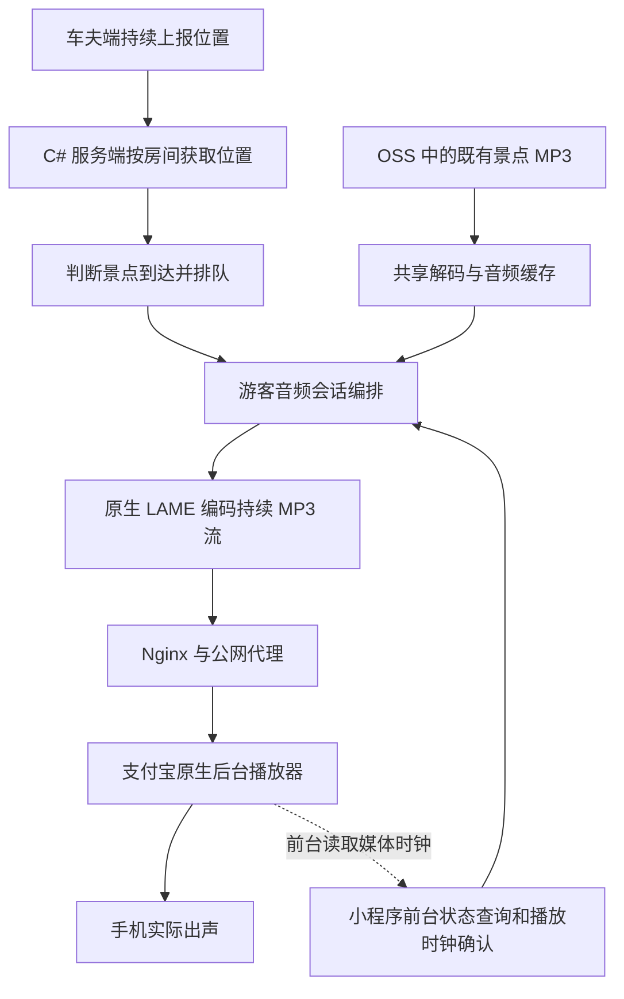

# 支付宝小程序息屏播放实现与技术风险说明

整理日期：2026-11-14。依据当前工作区源码、既有平台调研和当天最终 MP3 专项压测证据。

本文的“后台播放”指手机切到其他应用或锁屏后继续听音频；“服务端”指 C# API、音频处理和代理服务器。源码配置与已发布小程序版本可能不同，发布验收须核对实际包版本。

## 1. 当前结论

**支付宝端采用原生小程序技术栈：AXML、ACSS、JavaScript 和支付宝 `my.*` API。正式景点讲解采用服务端持续 MP3 流，由支付宝原生后台播放器播放。**

当前架构把景点判断和音频切换放在服务端，可以降低游客端 JavaScript 在后台挂起后无法切换下一景点的风险。40 房间、80 游客的服务端链路已通过本轮专项复核。

**后台/锁屏播放仍有技术风险，现有证据不足以承诺所有 Android、iPhone 都能长时间连续出声并在断网后自动恢复。** 这是尚待真机验收的能力边界，不代表已经确认所有设备都会失败。建议将锁屏连续播放列为独立发布验收项。

## 2. 目前息屏播放是如何实现的

实现的核心是：**小程序在前台启动一条持续音频流，支付宝原生后台播放器负责播放；息屏后的到站判断和下一段音频切换由 C# 服务端完成。** 技术栈围绕这条链路协作，通用依赖清单放在文末。

### 2.1 息屏前：建立会话并交给原生播放器

游客加入车夫房间、开始跟车导览后，小程序通过 `/TourAudioSessions` 创建自己的音频会话。服务端返回会话状态及带访问票据的 HTTPS 媒体地址。

客户端的 `tour-audio-session.js` 调用 `audio.playLive()`；`audio.js` 在配置允许、地址为 HTTPS 且平台 API 可用时，通过 `my.getBackgroundAudioManager()` 获取支付宝原生后台播放器，把媒体地址设置为播放器的 `src`。

这个地址对应 `/TourAudioSessions/{id}/media.mp3`。服务端以 `audio/mpeg` 持续返回数据，一次连接可以包含沿途多段讲解。客户端无需提前把整条路线下载成一个大文件。

### 2.2 息屏时：保留播放，停止前台状态轮询

应用进入后台时，`app.js` 的 `onHide()` 会检查配置和用户的“息屏听讲解”设置。如果允许后台听取，应用不因这次退后台动作主动暂停播放器；同时调用 `tourAudio.setForeground(false)`，停止导览音频会话的前台定时刷新。

如果用户关闭息屏听取，则主动暂停音频，并通知服务端暂停会话。后台开关不会强迫支付宝或操作系统保持小程序 JavaScript 运行。

此后，持续播放由已建立的原生媒体连接和服务端供流共同承担。即使游客端 JavaScript 被挂起，景点音频编排也不需要等待游客端定时器执行。能否在具体设备上保持连接并持续出声，仍受支付宝和系统行为影响。

### 2.3 息屏后到达景点：服务端切换音频内容

车夫端继续上报位置，C# 服务端根据所属房间的位置判断路线景点是否到达，并将对应讲解放入游客会话的播放队列。前一段没有播完时，按照当前业务规则等待它结束。

服务端取得既有景点 MP3，解码为 PCM 音频数据，再按会话顺序送入编码器，生成持续的 MP3 输出。当前启用共享解码及原生 LAME 编码，输出目标码率为 96 kbps。这里的解码、重新编码是处理已有录音，不需要把景点文案重新交给 MiniMax 合成。

**切换的是服务端持续流中的内容，正常景点切换无需客户端更换 `src`。** 因而游客手机已经锁屏时，下一站也可以由服务端直接接入当前音频流。

### 2.4 两个景点之间：维持连续音频输出

服务端 `ProduceAsync()` 按约 20 ms 的节奏生产 PCM 帧。有景点讲解时填入讲解内容；满足条件且有闲时音频时填入闲时内容；没有可播放内容时保留全零 PCM，编码为静音音频继续输出。

这样可以让媒体流在等待下一个景点时保持连续，减少播放器遇到文件结束或无数据空档后需要重新启动的情况。静音帧是在维持音频流，不能据此认定小程序 JavaScript 已获得系统保活权限。

媒体接口还设置 `no-store, no-transform`、`X-Accel-Buffering: no`，关闭应用响应缓冲，并持续写出、刷新音频数据。这些措施用于减少缓存或缓冲造成的延迟；所有代理节点是否正确执行仍需部署验证。

**只要媒体流仍保持编码和发送，静音等待也会消耗流量。** 流量预算应按音频会话实际连接及输出时长估算，不能只计算有讲解声音的分钟数。

### 2.5 返回前台：核对播放进度，必要时尝试恢复

导览页返回前台后重新刷新会话状态，读取原生播放器媒体时钟，并向服务端提交播放确认 `ack`。这样可以区分“服务器已发送到哪里”和“播放器实际播放到哪里”，对齐业务进度。

在跟车、未主动暂停且没有音频中断的条件下，当前代码对播放失败、卡住或断连提供最多 3 次前台自动恢复尝试。后台 JavaScript 被挂起期间是否能重建断开的连接，不在该机制的保证范围内；服务端重启导致会话丢失也不能等同于普通连接恢复。

### 2.6 各端职责

| 部分 | 息屏播放中的职责 | 关键前提 |
| --- | --- | --- |
| 车夫端 | 继续上报位置，让服务端知道车辆到达哪里 | 定位、网络和车夫端后台运行正常 |
| C# 服务端 | 到站判断、排队、读取已有 MP3、编排并持续编码输出 | 会话有效、音频资源可用、服务持续运行 |
| Nginx / 公网代理 | 将长连接音频连续转发给手机 | 带宽、超时、缓存与缓冲配置正确 |
| 支付宝原生后台播放器 | 在平台允许的后台条件下接收、解码和播放音频 | 实际设备支持该持续流，连接及音频焦点正常 |
| 小程序 JavaScript | 前台建连、交互控制、状态展示和返回前台后的对账恢复 | 不承担息屏后逐站换音频的必需调度工作 |

## 3. 景点播放链路

游客创建 `/TourAudioSessions` 会话后，播放器使用带票据的 HTTPS 媒体 URL；状态和控制接口使用鉴权请求。服务端在同一条媒体流中编排下一景点音频，小程序无需每到一站重新设置播放器 `src`。

共享解码与原生编码并不意味着“80 个用户共用一条输出连接”。每位游客仍有独立会话和媒体连接，暂停、进度等状态需独立管理。此次热缓存压测未观察到常驻 FFmpeg 进程，但仍有进程内编码和网络成本。

到站后可能等待前一段讲解播完。本轮最长排队 92.813 秒；这是当前排队规则的结果。手机原生缓冲还可能在此基础上增加实际出声延迟，不能用服务端 `audioStartedAt` 直接推断扬声器出声时刻。

## 4. 当前开关与保护机制

### 4.1 客户端源码配置

| 配置 | 当前值 | 实际含义 |
| --- | --- | --- |
| `background` | `true` | 应用后台策略开关，不是操作系统保活授权 |
| `backgroundAudio` | `true` | 允许使用原生后台播放器，还需平台 API 可用 |
| `serverTourAudio` | `true` | 启用服务端持续导览流 |
| `audioContinuityProbe` | `true` | 音频连续性探针能力，不代表探针已经在全部真机通过 |
| `diagnostics` | `true` | 联调诊断；源码注释要求上线前改回关闭，发布时需核对 |
| `routeCorrection` | `false` | 当前未启用此路线修正开关 |
| `driverHostInApp` | `true` | 启用车夫 APP 主持相关策略 |

另外还有用户本地 `screen-off-listening` 开关。是否允许后台听取由配置和用户设置共同决定。当前 `app.json` 中没有微信式 `requiredBackgroundModes` 配置，不能直接照搬微信配置认定支付宝已获得后台能力。

### 4.2 服务端源码配置

| `TourAudio` 配置 | 当前值 | 含义 |
| --- | --- | --- |
| `SharedDecodeEnabled` | `true` | 共享源音频解码结果 |
| `BinaryRoomAudioEnabled` | `true` | 房间音频使用优化后的二进制路径；本轮无讲话，不构成该场景完整验收 |
| `SharedLocationEnabled` | `true` | 共享房间位置读取 |
| `NativeEncoderEnabled` | `true` | 启用原生编码路径，本轮观察到 LAME 映射 |
| `OutputBitrate` | `96k` | 每游客输出流目标码率 |
| `MaxSessions` | `128` | 会话配置上限，不是已验证容量 |
| `MaxMinutes` | `120` | 当前会话时限，不能据此宣传无限续播 |

这是当前文件中的值，生产有效值还可能受环境配置覆盖。压测报告沿用本轮已开启优化配置的记录，并有原生 LAME 运行证据；不将文件值视为永久线上保证。

### 4.3 已实现的保护

- 前台约每 2 秒刷新会话状态；进入后台后停止该轮询，服务端持续供流不以游客 JavaScript 轮询或播放确认作为每段续播的前提。
- 前台根据原生播放器媒体时钟发送 `ack`，通过流标识和播放代次约束确认，防止旧响应误确认新连接。服务端发送完成不等于用户已听完，返回前台仍需对账。
- 跟车、非主动暂停且未被音频中断时，前台针对失败、卡住或断连有最多 3 次自动恢复尝试，恢复间隔按尝试次数递增。它不是后台无限自动重连保证，也不能保证重建进程重启后丢失的会话。
- 音频命令通过 RxJS 队列串行执行；会话所有权、登录版本和代次校验用于隔离旧操作。
- 暂停、录音和系统中断等有独立状态处理，恢复需尊重用户主动暂停意图。

## 5. 后台播放风险评估

下表的优先级用于安排验收和工程工作，不表示已经测得故障概率。

| 风险 | 可能影响 | 当前措施及剩余边界 | 优先级 |
| --- | --- | --- | --- |
| 支付宝版本和操作系统后台策略差异 | 锁屏或切后台后停播、系统回收连接 | 已用原生后台播放器；长连接 MP3 在不同设备上的持续出声仍待真机证明 | 高 |
| 后台断网、Wi-Fi/蜂窝切换或代理断连 | 流中断后无法立即恢复 | 有前台有限恢复；后台 JS 挂起时不能保证执行重连 | 高 |
| 原生播放器缓冲及媒体时钟行为 | 到站出声滞后、状态与听感不同步 | 有媒体时钟确认和诊断；已缓冲音频不能假定能随时撤回，需真机测量 | 高 |
| API 发布重启或多实例分流 | 会话丢失、控制请求找不到原会话 | 当前媒体状态在进程内；扩容需设计会话路由和恢复，Redis 不会自动解决 | 高 |
| 车夫位置停止或过期 | 游客仍能连接，但后续景点不触发 | 有位置时效检查；车夫端后台定位、网络及权限需独立验收 | 高 |
| 电话、录音、蓝牙及系统播放面板操作 | 被抢占、恢复失败或错误自动播放 | 有中断/暂停状态；必须覆盖真机音频焦点和用户主动暂停 | 中高 |
| 代理超时、缓冲、缓存及链路带宽不足 | 首音延迟、断流、请求超时 | 本轮提高带宽后通过；所有代理跳点仍需核对，入口资源未完整监控 | 高 |
| 会话到期 | 超过当前 120 分钟后停止或需要重新进入 | 属于配置边界，需验证到期提示和恢复体验 | 中 |
| 诊断开关与发布版本不一致 | 联调行为进入生产或结论对应错误版本 | 发布前核对实际小程序包、配置、后端有效配置和日志策略 | 中 |

**判定原则：服务端 `sentBytes` 增长、网络仍收包、返回前台后补回调，都不足以单独证明锁屏时手机一直有声音。** 必须结合真实听感或外部录音、播放器媒体时间、服务端时间线和操作记录。开发者工具也不能替代真机系统后台策略。

## 6. 建议的真机验收矩阵

至少覆盖一台 iPhone、一台当前出现过问题的 Android（如有）及一台省电策略较严格的 Android，记录机型、系统、支付宝版本、小程序版本、网络和电量策略。使用体验版或正式包脱离调试器运行。

| 场景 | 执行动作 | 通过标准 |
| --- | --- | --- |
| 完整基线 | 前台完整走一条路线 | 章节对应正确、声音可听、完成记录与媒体播放一致 |
| 长时间后台 | 分别切后台/锁屏 30 分钟、60 分钟，覆盖接近 120 分钟的时限边界 | 到配置到期前持续出声；到期行为明确；不把到期停止误判为随机故障 |
| 锁屏后新到站 | 先锁屏，再让车夫驶入后续景点 | 无需亮屏即可听到正确新景点，记录排队和实际出声延迟 |
| 无讲解间隔 | 当前内容播完，保持锁屏，稍后进入下一景点 | 新内容能继续出声，连接没有因空闲被中间层关闭 |
| 弱网与切网 | 锁屏时切 Wi-Fi/蜂窝、短暂断网后恢复 | 记录是否自动恢复及耗时；若只能回前台恢复，明确产品限制且可操作恢复 |
| 音频焦点 | 来电、录音、耳机插拔、蓝牙切换 | 中断和恢复合理，无重叠播放，不违反用户暂停意图 |
| 系统面板控制 | 在锁屏面板暂停后返回应用 | 保持主动暂停，不被后台/前台刷新擅自恢复 |
| 进度对账 | 锁屏听完多站后回到前台 | 正确同步媒体播放进度，无提前完成、漏记或重复推进 |
| 服务端故障 | 在专门测试窗口重启 API 或模拟连接失效 | 错误可识别，明确能否重连或需重建会话，不悄然显示正在播放 |

验收记录应保存操作时刻、实际出声证据和客户端诊断。对于无法全自动恢复的场景，先定义产品允许的恢复方式，再判定是否符合上线要求；不要将可接受的限制包装成“无风险”。

## 7. 发布与容量判断

现有原生客户端和 C# 技术栈能够支持本次已验证的服务端场景，目前没有证据要求通过更换语言或框架解决性能问题。更直接的后续工作是补齐真机后台验收、代理全链路监控、会话恢复和多实例路由设计。

本轮 40 车 / 80 游客满载整机 CPU 平均 17.44%、峰值 18.65%，API 全程 RSS 峰值 614.86 MiB，说明本场景有资源余量；不能据此承诺更大规模、多语言冷缓存或长时间运行。详见[压测总结](./pressure-test-summary-20261114.md)。

**发布结论应拆分为：服务端景点 MP3 链路已验证；支付宝原生后台连续出声、异常恢复和到期体验待真机验收。**

## 8. 依据与参考

客户端源码位于本仓库：

- `apps/mp-alipay/package.json`、`scripts/build.cjs`、`README.md`：依赖、构建及原生工程结构。
- `apps/mp-alipay/src/config.js`、`app.json`、`app.js`：配置、平台声明和生命周期。
- `apps/mp-alipay/src/services/audio.js`、`tour-audio-session.js`、`background-listening.js`：播放器、持续会话、后台开关。
- `apps/mp-alipay/src/services/audio-command-queue.js`、`location.js`、`http.js`：控制串行化、车夫位置及请求。

后端仓库根目录为 `D:/workspace/amh/code/CulturalTourism/git_src/CulturalTourism_System`：

- `CulturalTourismSystem.WebApi/CulturalTourismSystem.WebApi.csproj`、`CulturalTourismSystem.Service/CulturalTourismSystem.Service.csproj`：框架与依赖。
- `CulturalTourismSystem.WebApi/appsettings.json`：`TourAudio` 配置。
- `CulturalTourismSystem.Service/Chat/TourAudioSessionService.cs`：进程内会话、到期、控制及播放确认。
- `CulturalTourismSystem.Repository/SqlSugarDbConfig.cs`：数据库类型。

既有研究：[支付宝息屏播放调研](./alipay-screen-off-node-research-2026-11-10.md)。其中引用的官方参考如下；本次整理未重新在线核验官方页面，最新平台约束及发布要求应以官方文档与实际真机表现为准：

- [支付宝小程序运行机制](https://opendocs.alipay.com/mini/framework/operating-mechanism)
- [BackgroundAudioManager](https://opendocs.alipay.com/mini/00bifu)
- [后台音频概览](https://opendocs.alipay.com/mini/08i49n)
- [音频常见问题](https://opendocs.alipay.com/support/01rb9e)
- [app.json 配置](https://opendocs.alipay.com/mini/framework/app-json)

## 9. 附录：相关技术栈

| 层次 | 当前技术 | 在项目中的作用 |
| --- | --- | --- |
| 支付宝客户端 | 原生 App / Page、AXML、ACSS、JavaScript、`my.*` | 页面、生命周期及原生媒体能力；本端运行包不依赖 Vue、uni-app 或 WebView |
| 共享逻辑 | TypeScript | 地理坐标、路线触发、语言和房间相关纯逻辑 |
| 音频控制队列 | RxJS 7.8.2 | 串行处理异步音频命令 |
| 文本处理 | marked 4.3.0 | Markdown 解析，与后台保活无直接关系 |
| 构建与检查 | pnpm 11.7.0、自定义 Node.js 脚本、TypeScript `^6.0.3`、esbuild 0.28.1、Node.js test runner | 转译至 ES2017 / CommonJS、打包与静态工程检查；不替代真机验收 |
| API 与业务 | C#、.NET 10、ASP.NET Core WebAPI | 业务接口及持续媒体会话调度 |
| 数据访问 | PostgreSQL、SqlSugarCore `5.1.4.*` | 持久化路线、用户和游览进度；具体 ORM 补丁版本由依赖解析决定 |
| 系统缓存 | Redis | 缓存能力；媒体运行态仍在 API 进程内 |
| 文件存储 | 阿里云 OSS SDK，WebAPI 2.14.1 / Service 2.13.2 | 存储和读取已有 MP3 等资源 |
| 音频处理 | PCM、FFmpeg、原生 libmp3lame | 音频解码、共享缓存、连续编码及回退路径 |
| 网络与部署 | HTTPS 长响应 MP3、JSON API、WSS；Linux、systemd、Nginx | 媒体供流、控制及房间事件；媒体不是 HLS 或 WebRTC |

构建使用 TypeScript `transpileModule`，不等于完整语义类型检查。以上依赖版本来自当前源码声明；已发布版本和生产有效配置需单独核对。
