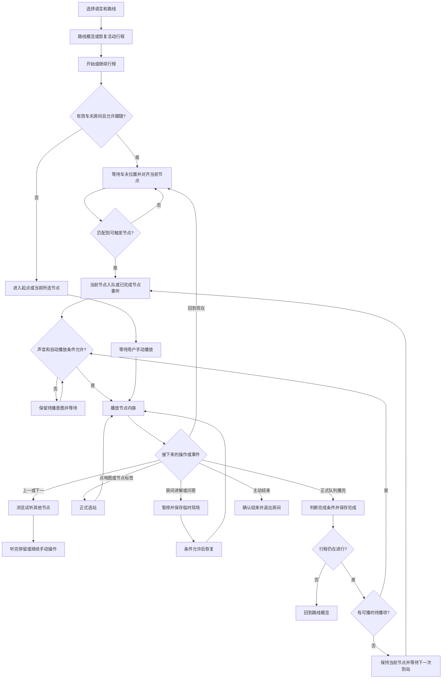
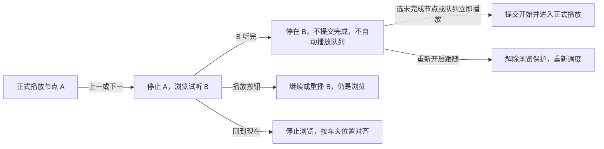
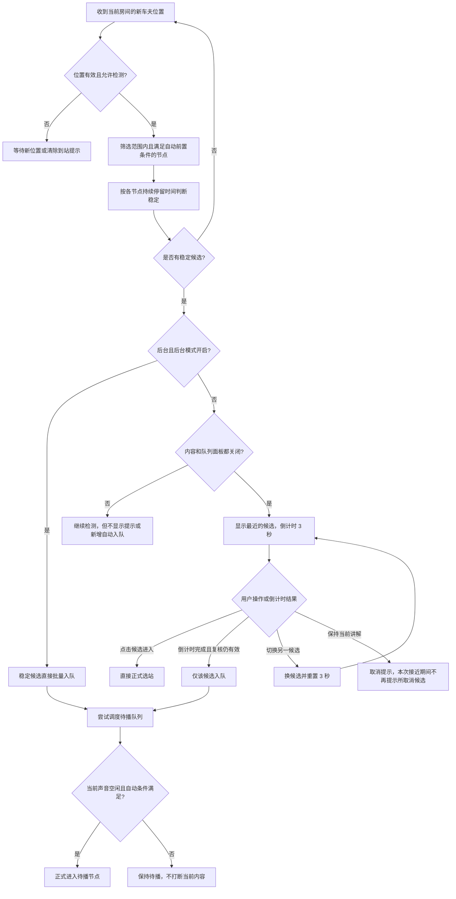
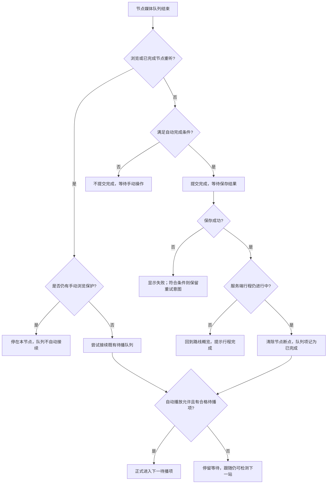
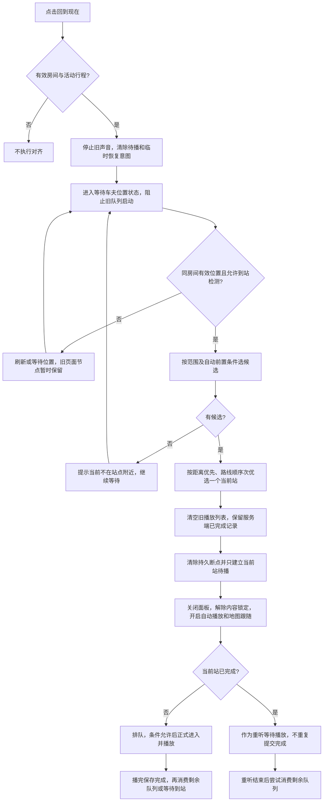
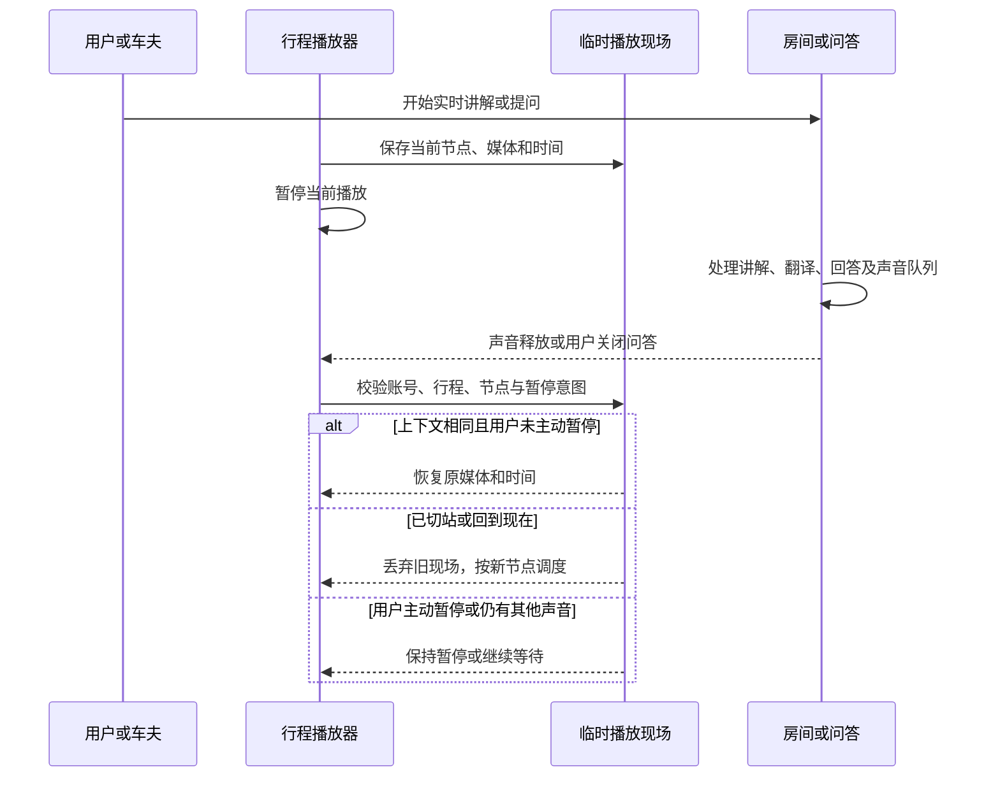
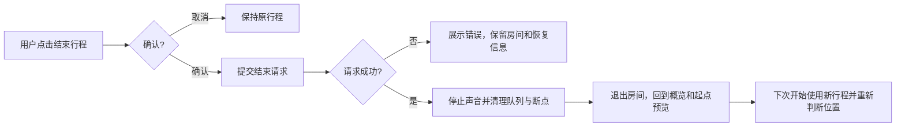

# 支付宝小程序行程与浏览业务动线（当前实现）

核对日期：2026-11-09。

本文回答“用户在导览中浏览、选站、播放、暂停、回到现在之后，系统究竟如何接续”。范围以具有“回到现在”按钮的支付宝原生小程序为准，依据当前源码与已有回归测试整理，不代表线上已经发布或完成真机验收。H5 只在末尾说明与本题直接相关的差异。

本文记录现状；容易误解或存在边界的行为单独标明，不把建议的产品规则写成已经实现的能力。

## 1. 先区分六件事

| 概念 | 业务含义 | 与其他状态的关系 |
| --- | --- | --- |
| 正在查看的节点 | 页面标题、图片、正文对应的景点 | 可以只是浏览，不一定是正式行程节点 |
| 正式行程节点 | 服务端行程里当前开始的节点 | 由正式进入操作提交 `start`；纯浏览不改它 |
| 当前车夫所在节点 | 用有效车夫坐标按站点范围匹配到的节点 | 可以与正在查看、正在播放的节点不同；不在范围内时没有匹配节点 |
| 正在播放的节点／媒体 | 此时占用播放器的讲解或音视频 | 浏览试听、正式讲解、单独视频都有可能占用它 |
| 待播队列 | 本次行程里已经安排过的节点及其状态 | 有待播、播放中、完成、跳过；不是整条路线自动全部入队 |
| 到访与完成 | `visitedStageIds` 表示到访，`completedStageIds` 表示完成 | 到访、开始、播放进度、跳过和完成不能混为一谈 |

**最核心的区别：同样是手动操作，“上一／下一节点”是浏览试听，“点地图或内容里的节点标签”在活动行程中是正式选站。** 两种入口对进度和续播的影响不同。

## 2. 总体业务动线

图中的自动启动均受自动播放、内容锁定、用户暂停、问答、房间声音、前后台和活动行程状态约束。详细例外见后续章节。

## 3. 不同操作入口到底做什么

| 用户操作 | 是否切换页面节点 | 是否停止当前声音 | 是否修改正式行程进度 | 后续行为 |
| --- | --- | --- | --- | --- |
| 打开／关闭当前内容面板 | 不切节点 | 不主动停止 | 否 | 展示或收起当前节点正文 |
| 打开／关闭播放队列 | 不切节点 | 不主动停止 | 否 | 查看队列；有视频时不能打开队列 |
| 上一节点／下一节点 | 是 | 立即停止旧播放，尝试播放目标节点 | 不提交开始或完成 | 进入手动浏览；听完不自动接续 |
| 活动行程中点击地图节点 | 是，正式进入成功后切换 | 成功切站时停止旧播放 | 未完成节点提交 `start` | 正式播放，播完可以提交完成 |
| 活动行程中点击内容节点标签 | 同地图选站 | 同地图选站 | 同地图选站 | 函数虽然叫 `browse`，业务是正式进入 |
| 没有活动行程时点击地图／节点入口 | 是 | 停止旧播放 | 否 | 只展示目标节点，不自动开始播放 |
| 点击队列待播项“立即播放” | 是，或消费当前待播意图 | 切站时停止旧播放 | 未完成目标提交 `start` | 可以绕过关闭自动播放或锁定的自动启动限制，仍须等待房间释放声音 |
| 点击待播项“跳过” | 通常不切页面节点 | 不主动打断其他节点声音 | 不提交完成 | 该队列项记为已跳过 |
| 点击播放／暂停 | 不切节点 | 暂停或恢复当前媒体 | 不会单凭点击播放转成正式选站 | 保留当前浏览／正式模式 |
| 点击“重新播放本节点” | 不切节点 | 重建当前节点队列 | 保留原模式 | 清除持久断点，前置音频也重新参与播放 |
| 点击“回到现在” | 成功匹配后切换 | 开始对齐时就停止旧行程声音 | 匹配未完成节点后正式进入 | 清空整个旧播放列表，当前节点重新建队并恢复自动跟随 |
| 拖动地图、缩放、路线显示开关 | 不切节点 | 不停止 | 否 | 只影响地图展示；不等于关闭位置检测 |
| 返回路线概览 | 回到路线列表展示 | 此入口没有直接停止声音 | 不结束行程 | 自动调度受页面阶段限制；若要终止行程需点结束 |

### 3.1 手动浏览为什么会停住

上一／下一节点会设置“手动浏览保护”。此时即使后续近站节点已经入队，也不会自动抢走用户正在浏览的内容。

浏览结束后有三种常见出口：

- 点击地图／内容节点标签或队列“立即播放”，正式进入未完成节点。
- 点击“回到现在”，重新对齐车夫位置。
- 关闭后重新开启“跟随车夫”，清除手动浏览保护；用户主动暂停仍会被尊重。

**只点击播放器的播放按钮，仍然是当前模式下的播放。浏览状态不会因此变成正式行程。** 对已完成节点手动选站也是重听，仍采用浏览保护。

## 4. 从进入页面到开始、恢复行程

### 4.1 进入页面

1. 加载用户、语言、路线目录和当前路线详情，查询活动行程。
2. 没有活动行程时，默认展示路线概览和起点预览。
3. 存在活动行程时，根据入口决定展示导航还是路线列表；路线列表入口不会因为有活动行程就强行跳进导航。
4. 恢复页面时，以当前服务端完成记录校正已保存队列；普通重新打开页面会恢复同一行程的待播项，其他路线或其他行程的保存队列不复用。显式点击“回到现在”则会覆盖这份旧队列并从当前节点重新建立。

### 4.2 开始或继续

| 条件 | 当前动线 |
| --- | --- |
| 没有进行中行程，点击开始 | 创建新行程 |
| 同一路线有进行中行程，点击继续 | 使用原行程 |
| 另一条路线有进行中行程 | 先询问是否结束原行程；确认后再继续目标路线 |
| 已加入有效车夫房间，且没有关闭跟随 | 先等有效车夫位置，匹配站点后再开始讲解，不先补播起点或旧断点 |
| 未加入房间，或手动关闭跟随 | 新行程正式进入起点；原行程进入当前所选节点；保留手动播放入口 |

当前支付宝实现中，没有有效车夫房间时不会请求游客本机定位，也不会自动开启跟随。开始动作虽可正式进入节点，但其待播意图属于自动启动；自动播放关闭时，要再手动点击播放。

已经结束后重新开始，会使用新的行程；加入房间后从车夫当前位置开始对齐。重新入房或首次恢复跟随也会先处理位置对齐，防止先播放旧队列。

## 5. 车夫移动、近站提示与入队

### 5.1 位置来源和判定

支付宝只读取当前有效游客房间的车夫位置。位置查询每次完成后约 1 秒再发起下一次查询，样本有效期为 15 秒；相同或倒序样本不会被当作新到站事件。

默认近站策略是：可接受定位精度不超过 65 米、稳定停留至少 1.5 秒；缺少独立范围配置时，默认接近阈值 50 米、解除阈值 80 米。地点圆形／多边形范围、节点触发半径与范围自己的配置可以改变实际判定距离。

地图坐标和范围计算使用相应坐标转换；当前配置 `routeCorrection=false`，因此不能把“沿路线修正坐标”描述为已经开启的能力。范围匹配仍然存在。

### 5.2 正常到站流程

前台多候选不是一次全加：先提示最近候选，倒计时后只加入该候选，后续位置更新可以再提示其他候选。后台模式下稳定候选可以批量入队。

已入队、已完成、已跳过的节点不会因重复接近自动再次加入。同一批追加项按距离、路线顺序排序；既有队列通常保留已有次序。“回到现在”是更强的重置动作，会清空旧播放列表，只重新建立当前匹配节点。

### 5.3 到访前置条件

配置了自动到站前置节点的终点，必须在本次行程的到访记录里满足前置条件，才可自动触发。“跳过前面所有节点”不会自动解锁它。

当前实现会对被其他节点引用为前置条件的站点按需提交 `arrive`；这不等于全部节点一入队都要提交到访。前置条件限制自动触发和自动队列选取，手动选站／播放不受同一前端条件限制；服务端最终仍可能校验请求。

## 6. 节点内部的播放、暂停与完成

### 6.1 一个节点的播放顺序

没有配置的部分会略过。正式播放已完整播过的前置音频可以在本次行程内去重；浏览和显式重播会绕过去重。“回到现在”清除的是播放断点，并不清除本次行程的前置音频已播记录，因此“从头播放”指从本次生成的队列开头开始。

### 6.2 播放控件

| 操作 | 当前效果 |
| --- | --- |
| 暂停 | 暂停当前媒体，记住是用户主动暂停，阻止自动接续 |
| 继续 | 有当前媒体时继续当前媒体；没有时按当前浏览／正式模式重建队列 |
| 重新播放本节点 | 删除持久断点，重建节点队列；不改变浏览／正式模式 |
| 进度条、前后 15 秒 | 调整当前媒体时间，不是整站全部媒体的累计进度；不会自动跳到另一个节点 |
| 更换讲解员 | 停止声音并更新章节；随后用户重新播放。旧讲解员断点不匹配新讲解员 |
| 修改跳过附加音频开关 | 停止当前播放，下一次播放按新配置生成队列；节点视频仍保留 |
| 单独观看节点视频 | 保存正在播放的主队列现场，播放独立视频；结束、跳过、失败后尝试恢复主队列，不直接完成本站 |

### 6.3 哪些情况算播完

不能用“全部音视频必须毫无错误地看完”概括当前实现，实际完成口径如下：

| 内容情况 | 自动完成规则 |
| --- | --- |
| 浏览试听 | 始终不自动提交完成 |
| 正式节点包含讲解章节 | 队列走到结束、讲解章节都有音频地址、没有主讲解失败时，可以提交完成 |
| 主讲解音频失败／缺录音 | 停住并提示错误，不提交自动完成；可重试或阅读 |
| 附加音频、插播视频、节点视频失败 | 提示并跳过该附加媒体继续；有主讲解的节点最终仍可能完成 |
| 没有讲解章节、只有节点视频 | 整站队列中的节点视频必须自然结束；跳过或失败不算完成 |
| 只有额外音频，没有讲解章节也没有合格节点视频 | 播放结束也不足以触发自动完成 |
| 单独播放视频或附加音频 | 本次单独播放不提交本站完成 |
| 正式节点的手动完成函数 | 可提交手动完成来源；当前页面模板未提供可见“完成本节点”按钮，不能描述成常规用户入口 |

时间快进没有“必须听够百分之多少”的本地校验。有主讲解节点能否完成由队列结束、媒体条件和服务端响应判断，不能据此认定每秒都被实际收听。

### 6.4 播完以后去哪里

正常跟随场景下，播完优先消费已存在的待播项；没有待播项就等待后续到站，**不会仅按路线编号把下一站全部自动播出来**。待播节点不要求在开始播放这一刻重新位于车夫附近，因此也可能播放之前排队但已离开的站点。

源码另有“自动播放开着且位置检测关闭时，寻找未完成、未跳过节点”的后备分支；但正常关闭跟随会同时关闭自动播放，不能据此把“关闭跟随”描述为启用顺序连播模式。

## 7. 队列里的完成、跳过、待播怎样变化

| 动作或事件 | 旧项／目标项的状态变化 | 是否自动补播 |
| --- | --- | --- |
| 正常近站入队 | 新节点加入待播；同节点去重 | 自动条件允许时播放 |
| 正式进入一个未完成节点 | 目标记为待播，实际启动时记播放中 | 参加正式完成流程 |
| 正式切到另一个未完成节点 | 立即停止旧播放，移除旧当前播放意图；目标插到队首，其他待播项保留 | 旧当前节点不会因这次切站再次自动消费 |
| 上一／下一浏览打断正式播放 | 立即停止媒体，旧队列项没有统一改为跳过 | 保护解除后可能被消费；队列状态可能暂时仍显示旧播放中 |
| 队列“跳过” | 对应待播项记已跳过 | 不再自动入队；可以从地图／节点标签显式选它 |
| 正式节点保存完成成功 | 对应项记已完成 | 自动调度排除它，手动仍可重听 |
| 回到现在 | 清空旧播放列表和旧断点，只建立当前匹配节点 | 后续节点等待新的有效位置重新入队 |

**现状提醒：手动正式切站和“回到现在”的范围不同。** 手动正式切站只清掉旧当前播放意图，把目标插到队首并保留其他待播项；显式“回到现在”会清空整个旧播放列表，因此不会再把之前手动播放到一半的节点作为旧待播项接回来。

## 8. 回到现在：等待、对齐、重排、播放、接续

### 8.1 生效条件

按钮只有开启位置跟随且页面不忙时可以点击。业务执行还要求有效游客房间、进行中的行程、导航页面、当前账号匹配。它读取车夫位置，不是“回到刚才听过的节点”，也不是只把地图移回车夫。

与普通近站流程不同，显式“回到现在”有可用位置和候选即可对齐，不额外走 1.5 秒稳定停留加 3 秒提示倒计时。

等待位置时旧声音已经停止、旧临时恢复现场已经清理，原页面节点可能暂时还显示。持久播放断点在成功对齐时删除；不能把等待状态理解为“旧声音照常播着”。

### 8.2 对齐到 D 时，各类节点如何处理

假设路线顺序为 `A → B → C → D → E → F`，位置匹配到 D：

| 原节点状态 | 对齐后的结果 |
| --- | --- |
| A 已完成 | 服务端完成记录保留，但旧播放列表项清除 |
| B 正在浏览／正式播放但未完成，位于 D 前 | 停止声音并从旧播放列表移除，不再补播 |
| C 从未入过队且未完成，位于 D 前 | 不创建旧跳过项，等待后续位置重新触发 |
| D 未完成或原来已跳过 | 作为唯一初始待播项，正式进入后播放 |
| D 已完成 | 完成记录保留，允许从当前生成队列开头重听 |
| E 已经待播 | 从旧播放列表移除，后续靠新的有效位置重新入队 |
| E 正式播放中，车夫实际在 D | 被停止并从旧播放列表移除，不恢复旧时间 |
| E 只是浏览试听、没有入队 | 不新增 E 的待播记录 |
| F 已完成或已跳过 | 服务端记录保留；本地旧播放列表项清除 |

显式“回到现在”不再把路线前序批量标为跳过，而是清除旧的本地播放安排。它只保留服务端已经完成的事实，并让后续节点等待新的有效位置重新触发；这不代表系统补写了到访或完成。

### 8.3 对齐后播放的特殊分支

- **房间正在讲解**：先切到匹配站点，当前站保留为唯一待播，等房间讲解和尾段声音释放。不会同时播放两路声音。
- **当前站未完成**：条件允许后提交 `start`，从新生成队列开头播放；播完按完成规则提交 `complete`。
- **当前站已完成**：重听，不再写开始或完成；旧队列已清空，重听结束后等待新的有效位置触发后续站点。
- **当前位置没有匹配站**：继续等待，不播放旧试听、不猜测远处节点、不补播起点。
- **多个节点范围重叠**：按距离优先、路线顺序次优选一个当前节点；不是同时播放全部候选。
- **终点前置条件未满足**：该终点不作为自动对齐候选；跳过其他站点不会补齐到访条件。

### 8.4 典型组合场景

| 场景 | 回到现在后的结果 | 当前站听完后 |
| --- | --- | --- |
| 浏览前面 B 一半，车夫在 D | B 停止，旧播放列表清空，D 从唯一新队列项开头播 | 后续节点等新的有效位置触发 |
| 浏览未来 E 一半，E 没入队，车夫在 D | E 停止，D 播放；E 不因试听入队 | 不会自动回 E 续听 |
| 正式进入未来 E 一半，车夫在 D | E 改为待播并保留，D 先播 | 可能再次播 E；旧时间断点不会自动恢复 |
| 当前 D 已经完成，再点回到现在 | D 重听，完成记录不变，旧播放列表清空 | 后续节点等新的有效位置触发 |
| D 从来没开始，房间实时讲解中 | 页面已对齐 D，D 先等待 | 房间释放后才开始 D |
| 在任意节点暂停后点回到现在 | 成功对齐时清除主动暂停，恢复自动播放意图 | 按自动调度接续 |
| 内容锁定或自动播放关闭后点回到现在 | 显式操作成功后解除锁定并开启自动播放 | 当前节点可自动播放，后续节点靠新位置重新入队 |
| D 播放期间车夫已经到 E | 普通近站检测可将 E 排队，不抢播 D | D 完成后接续 E |
| 在两站之间点击回到现在 | 停旧声音，提示继续跟随并等待可匹配位置 | 匹配到站后才播放 |
| 未开启跟随时尝试回到现在 | 按钮不可用，动作不改变原浏览状态 | 保持手动操作 |

## 9. 自动播放、内容锁定、位置检测和地图跟随

四者不是同一个开关：

| 控制 | 影响什么 | 不应混淆的边界 |
| --- | --- | --- |
| 底部“跟随车夫” | 联动位置检测、自动播放、地图镜头跟随 | 关闭时不会立即停止当前媒体；后续不再自动启动 |
| 队列“自动播放” | 是否自动开始待播内容 | 关闭不打断当前播放；仍可检测和排队，也可手动立即播放 |
| 队列“允许内容切换” | 关闭后设置内容锁定，阻止自动切站／启动 | 不等于暂停当前媒体；显式选站可以进入未完成节点 |
| 地图镜头跟随按钮／拖动地图 | 是否让地图镜头继续跟随车夫 | 取消镜头跟随不等于关闭位置检测、到站判断或声音 |
| 手动浏览保护 | 保护用户上一／下一浏览内容 | 独立于上述开关；只开启自动播放未必能解除它 |

自动调度还会等待：加载／保存结束、活动行程有效、页面可运行、没有问答／录音、用户未主动暂停、房间释放声音、播放器没有仍在处理的媒体、目标前置条件满足。

开启内容面板或队列会取消前台到站提示，但稳定到站候选仍会继续入队；面板打开期间不会自动开始新的队列项，关闭面板后恢复调度。它们本身不是通用的声音锁，已有待播项能否开始还要看自动播放、锁定和其他保护条件。

## 10. 暂时中断后的恢复

### 10.1 房间实时讲解

房间是否占用声音，不只看“现在有没有音频在响”。未暂停的有效讲解轮次、正在识别或翻译的尾段、待播译音和正在播放的译音都可能阻止景点播放。必须等对应输入和翻译、播放队列释放。

房间打断一般从原时间恢复；用户点“回到现在”属于主动改换上下文，清除旧房间恢复现场，不能再恢复旧试听。

### 10.2 问答与单独视频

进入问答时暂停景点声音，关闭后尝试恢复；用户已经主动暂停的内容不会因为关闭问答而自行播放。单独视频也使用临时现场，正常结束、跳过或失败后尝试恢复原主队列。

### 10.3 后台和重新打开

- 当前配置 `background=true`：隐藏页面后尽量维持音频和车夫位置轮询；当前视频会暂停。后台稳定到站可直接入队。
- 平台挂起 JavaScript、网络或音频后，无法保证继续到站和播放；本地测试不等于支付宝锁屏真机保证。
- 返回前台后刷新车夫位置、恢复订阅、校验临时现场；整轮已经播完时不从头再恢复该轮。
- 用户主动暂停后切后台再回来，仍保持暂停。
- 如果进程退出，正式节点可以使用匹配的持久断点；有效期为 6 小时。当前是按账号保存的一份断点，不是每个浏览节点都保存一个。
- 纯浏览不写正式持久断点，但在同一页面生命周期内，浏览试听也可能通过房间／问答的内存现场恢复。不能把“不写持久断点”等同于“任何情况下都不能续听”。

## 11. 异常、退出和行程结束

| 情况 | 当前处理 | 下一步 |
| --- | --- | --- |
| 主讲解无录音或加载失败 | 停在当前媒体并展示错误，不自动完成 | 用户重试或阅读；当前无可见手动完成按钮 |
| 附加媒体失败 | 显示错误并继续后续队列 | 最终是否完成看节点内容类型和完成条件 |
| 自动正式进入失败 | 不启动目标新播放，记录重试限制 | 网络／服务错误通常需等约 5 秒再由调度触发；业务拒绝不会无限重试 |
| 自动完成保存失败 | 不把本地队列伪记为完成 | 可重试的网络／服务错误保留完成意图，后续调度重试；成功后才接续 |
| 位置精度不足／过期／网络错误 | 清除或取消候选、倒计时和失效位置；部分弱帧有有限容错 | 等待新有效位置，不用游客本机位置兜底 |
| 普通跟随中位置失效 | 不再产生新的可靠到站判定 | 不是通用的音频停止指令，已经播放或已排队内容仍受原调度规则处理 |
| 回到现在期间位置失效 | 保持对齐等待，旧队列不得启动 | 新位置有效且匹配后再继续 |
| 房间断线 | 关闭车夫跟随及自动播放，清除旧位置 | 房间确认恢复后，按原跟随偏好重新校验 |
| 手动关闭跟随／离房 | 取消位置订阅和等待，关闭自动跟随 | 不自动补播断线期间路过的节点 |
| 账号切换或认证版本变化 | 拒绝旧账号请求及迟到回调，重建上下文 | 重新加载当前账号路线和行程 |
| 换语言／路线 | 停旧声音，加载对应语言路线，恢复与该路线匹配的记录 | 不是把旧语言断点直接挪到新语言 |

### 11.1 主动结束

### 11.2 自然完成

节点保存完成后，由服务端返回的行程状态决定是否整程结束，不能只依据“页面显示最后一个节点”。返回非进行中后，页面转到概览并提示完成；导航阶段的自动队列和到站检测不再继续。

自然完成分支没有与主动结束相同的清空队列、主动离房和显式关闭位置订阅步骤。文档不把这两种退出方式描述为完全相同。

## 12. 场景检查表

下表可作为产品评审和真机验收清单；“有测试支撑”仍不代表所有组合已经在真机复现。

| 编号 | 操作／事件 | 预期现状 |
| --- | --- | --- |
| S01 | 无房间开始行程 | 不请求游客定位；进入节点后等待手动播放 |
| S02 | 房间中途开始新行程 | 等车夫位置，从匹配站点开始，不先补播起点 |
| S03 | 上一／下一试听后自然结束 | 不写开始和完成，保持手动浏览保护 |
| S04 | 浏览时点击播放或重播 | 仍是浏览，不自动转为正式选站 |
| S05 | 活动行程中点地图／内容节点 | 未完成节点正式开始，正常播放可完成 |
| S06 | 手动点已完成节点 | 重听，不重复写完成，保护当前重听 |
| S07 | 正式播放中又正式选另一站 | 停止旧播放并移除旧当前播放意图，目标插队；其他待播项保留 |
| S08 | 播放中接近其他站 | 通过近站提示入队，不抢断当前播放 |
| S09 | 前台多站重叠 | 候选逐个倒计时入队；换候选会重置倒计时 |
| S10 | 关闭到站提示后仍在原范围 | 不重复提示所取消候选，离开后才可能再次提示 |
| S11 | 已跳过站再次接近 | 不自动重复入队，可手动选站或回到现在重新对齐 |
| S12 | 关闭自动播放后播完当前站 | 保存完成，但后续保持待播 |
| S13 | 内容锁定时接近下一站 | 不自动切换，解锁后才尝试接续 |
| S14 | 用户暂停后车夫继续移动 | 不自动恢复用户暂停的声音 |
| S15 | 浏览未播完点回到现在 | 停旧声音，清空旧播放列表，播匹配站点 |
| S16 | 回到现在时匹配站已经完成 | 重听，不重复完成，后续等新位置触发 |
| S17 | 回到现在时没有有效站点 | 等待，不恢复旧试听、不猜远处站点 |
| S18 | 回到现在前正式播过未来站 | 未来站从旧播放列表移除，之后靠新位置重新入队 |
| S19 | 主讲解失败与附加音视频失败 | 前者阻止完成；后者可能跳过继续，不混为同一种错误 |
| S20 | 纯视频站自然结束／跳过／失败 | 只有整站视频自然结束可自动完成 |
| S21 | 单独看视频打断主讲解 | 结束、跳过或失败后恢复原主讲解位置 |
| S22 | 房间讲解抢占与释放 | 暂停景点并保存现场，尾段处理和声音释放后恢复 |
| S23 | 问答关闭、后台回来 | 按当前上下文恢复，用户暂停不被覆盖 |
| S24 | 自动完成保存失败后恢复网络 | 成功保存后才标完成并接续，不重复伪造完成 |
| S25 | 终点前置到访未满足 | 不自动触发；跳过前序不会满足条件 |
| S26 | 主动结束失败／成功 | 失败保留原房间；成功清理并离房 |
| S27 | 自然完成后与主动结束后 | 两种清理方式有差异，分别验收 |
| S28 | 切账号、切路线或过期回调到达 | 旧内容不允许污染新上下文 |

## 13. 当前容易误解、需要产品留意的边界

1. **入口语义不统一**：上一／下一是浏览，内容标签和地图是正式进入。只说“手动浏览”无法唯一判断后续进度。
2. **正式切站采用插队语义**：旧当前播放意图被清掉，目标站插到队首，其他待播项保留；上一／下一仍是浏览，不会转成正式选站。
3. **跳过是播放安排，不是完成**：队列中的跳过项不会自动补播，也不会被补成服务端完成或真实到访。
4. **回到现在会改偏好**：成功后重新开启自动播放、解除内容锁定并清除主动暂停。
5. **“从头”有前置音频去重边界**：回到现在删除播放断点，但不清除行程级前置音频已播记录。
6. **播完口径取决于内容类型**：附加媒体出错、跳过不一定阻止有主讲解节点完成；纯视频站口径更严格。
7. **等待现在与普通跟随不同**：前者停止旧声音并阻止旧队列，后者位置异常不等于自动暂停全部已排内容。
8. **回到现在是播放列表重置**：它清空旧播放列表，不把未完成前序节点伪造为跳过或完成；后续节点重新依赖有效位置入队。

这些是从当前实现识别出的行为与边界；本轮同时收敛了正式切站、状态语义、面板入队和重复触发保护。

## 14. 核对依据与其他端

### 14.1 主要源码

| 位置 | 核对内容 |
| --- | --- |
| [导览页面逻辑](../apps/mp-alipay/src/pages/tour/index.js) | `browseBy`、`browse`、`marker`、`enter`、`returnToNow`、`alignDriverPosition`、`complete`、`startNextSequence`、恢复与退出 |
| [底部播放器](../apps/mp-alipay/src/pages/tour/playback-dock.axml) | 回到现在、跟随、上一／下一、进度与队列入口 |
| [内容与节点入口](../apps/mp-alipay/src/pages/tour/experience.axml) | 节点标签和地图、概览、结束入口 |
| [正文控制](../apps/mp-alipay/src/pages/tour/story.axml) | 播放、重播、讲解员、独立视频，无可见手动完成按钮 |
| [队列面板](../apps/mp-alipay/src/pages/tour/playback-queue.axml) | 自动播放、内容锁定、附加音频设置、立即播放与跳过 |
| [队列生成与完成判定](../apps/mp-alipay/src/core/tour.js) | `queueFor`、`canCompleteAudio`、站点候选匹配 |
| [音视频播放器](../apps/mp-alipay/src/services/audio.js) | 媒体失败、跳过、自然结束、播放代次隔离 |
| [车夫位置读取](../apps/mp-alipay/src/services/location.js) | 仅车夫位置、时效、轮询、重复采样与房间隔离 |
| [近站默认策略](../packages/ts-shared/src/geo-range.ts) | 精度、范围、停留与有效期 |
| [自动触发前置条件](../packages/ts-shared/src/tour-auto-trigger.ts) | 到访合并与终点前置条件 |
| [支付宝配置](../apps/mp-alipay/src/config.js) | 当前后台模式开启、路线位置修正关闭 |

### 14.2 已有测试与相关文档

- [页面和队列行为测试](../apps/mp-alipay/tests/pages.test.cjs)。
- [入口行为和后台恢复测试](../apps/mp-alipay/tests/h5-parity.test.cjs)。
- [回到现在和重新入房测试](../apps/mp-alipay/tests/driver-position-resume.test.cjs)。
- [车夫跟随测试](../apps/mp-alipay/tests/driver-follow.test.cjs)。
- [近站候选测试](../apps/mp-alipay/tests/nearby-arrival.test.cjs)与[队列调度测试](../apps/mp-alipay/tests/nearby-scheduling.test.cjs)。
- [房间声音优先级测试](../apps/mp-alipay/tests/room-audio-priority.test.cjs)。
- [视频与单独媒体测试](../apps/mp-alipay/tests/tour-media.test.cjs)。
- [回到现在专项说明](./driver-position-resume.md)与[车夫房间集成说明](./driver-commentary-integration.md)。

### 14.3 H5 适用边界

H5 同样区分上一／下一浏览与地图／列表正式选站，但当前“回到现在”的车夫位置对齐入口位于支付宝端。H5 的 `markInterruptedSequence` 会将被打断的播放中队列项记为跳过；支付宝显式“回到现在”则会清空整个旧播放列表，并重新建立当前匹配节点。

H5 还通过 `proximity`／`sequential` 区分定位等待和顺序推进。不能把 H5 的顺序推进、旧节点跳过规则直接套到支付宝。历史文档中的本机定位、全端统一规则、附加媒体设置等描述，也应以具体端当前源码为准。
